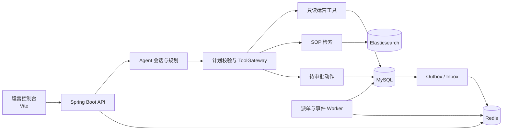
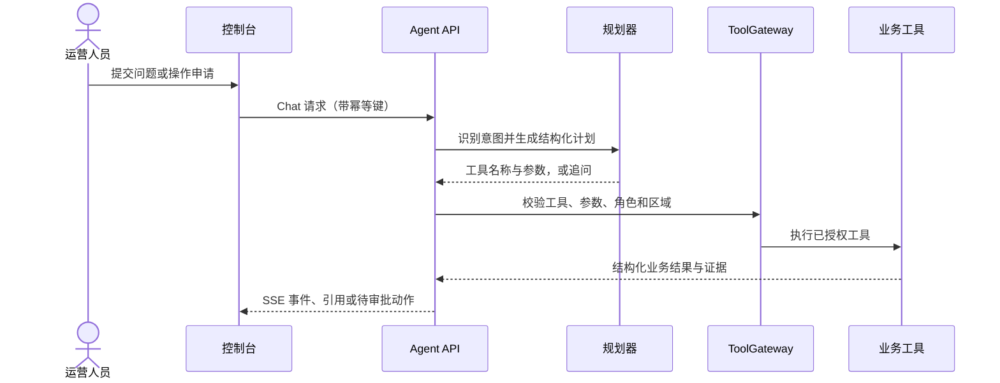

# PeakDispatch Agent：智能配送与运营 Agent


PeakDispatch Agent 是一个面向同城配送场景的运营平台原型。项目围绕订单派单、运营查询和异常处理构建：后端负责订单与运力状态，运营 Agent 使用经过授权的业务工具回答问题、解释派单证据、检索操作规范，并把高风险变更交给第二位运营人员审批。

Agent 默认使用可重复的确定性规划器，也可以配置 DeepSeek 兼容接口。工具调用经过参数、角色和区域范围校验；回答由校验后的工具结果生成。当前定位是可运行、可测试的演示项目，不宣称生产级调度优化或真实模型质量已经验证。

## 项目能力

- **配送与派单**：订单状态流转、骑手在线与心跳、容量预留、派单 Offer、接单和超时回收。
- **Agent 运营查询**：查询区域指标、订单时间线、诊断派单问题、解释派单记录及比较高峰容量方案。
- **只读派单模拟**：复用路线预览能力，检查区域、运力、心跳和订单时限；模拟不创建 Offer，也不预占容量。
- **SOP 知识检索**：按区域和生效时间搜索知识文档，回答保留检索摘录及来源；无可用证据时明确返回无证据结果。
- **审批与审计**：取消、改派和改期先生成待审批动作；审批校验申请人与审批人分离、订单版本、区域权限、有效期和幂等键。
- **可恢复的 Agent 会话**：支持分轮补充缺失信息、恢复会话历史、SSE 事件续读及运行检查点恢复。
- **运营控制台**：提供运营数据视图和 Agent 对话界面，展示引用、审批参数与会话状态。

## 架构



### Agent 请求路径



审批类工具只创建待处理动作，不直接修改订单；业务变更由双人审批流程完成。用户身份、角色和区域范围来自认证上下文，不接受模型参数覆盖。

## 技术栈

| 范围 | 技术 |
|---|---|
| 服务端 | Java 21、Spring Boot 3.5、Spring Security、Maven 多模块 |
| 业务数据 | MySQL、Flyway、JDBC、版本 CAS 与事务 |
| 异步与并发 | Redis、Redis Streams、Lua、Outbox/Inbox |
| 知识检索 | Elasticsearch、BM25、区域及有效时间过滤 |
| Agent | 确定性 Mock 规划器、可选 DeepSeek 兼容结构化规划器、工具白名单 |
| 控制台 | Vite、JavaScript、CSS、SSE |
| 测试 | JUnit、Spring Boot Test、H2、Mockito、可选 Testcontainers |

## 模块结构

```text
peakdispatch-domain/          订单、骑手、派单等领域模型
peakdispatch-application/     用例、Agent 规划与工具边界
peakdispatch-infrastructure/  MySQL、Redis、Elasticsearch 适配器及迁移
peakdispatch-api-worker/      HTTP API、认证、后台 Worker 与集成测试
frontend/                     运营控制台
docs/                         需求、设计、实现审计和测试报告
scripts/                      数据保护、基础设施测试及运维脚本
```

## 快速开始

需要 Java 21 和 Docker Compose v2。首次启动时，从示例创建本地配置并填写本机使用的密码：

```powershell
Copy-Item .env.example .env
# 编辑 .env，设置本地配置值；不要把 .env 提交到仓库。
docker compose up --build -d
```

服务就绪后访问：

- 运营控制台：<http://localhost:4173>
- API 健康检查：<http://localhost:8080/actuator/health>

本地演示账号及角色配置位于 `peakdispatch-api-worker/src/main/resources/application-demo.yml`；密码通过本地 `.env` 配置。演示账号不等同于生产身份系统。单独启动控制台时，在 `frontend/` 目录运行 `npm.cmd ci` 和 `npm.cmd run dev`。

默认 Agent provider 是 `mock`，不调用外部模型。启用 DeepSeek 兼容规划器时，通过本地环境变量设置 `PD_AGENT_MODEL_PROVIDER=deepseek`、`DEEPSEEK_API_KEY`、`DEEPSEEK_BASE_URL` 和 `DEEPSEEK_MODEL`。规划器只返回结构化计划；应用层会再次校验，最终回答仍由业务工具结果生成。

## API 概览

- `POST /api/v1/ops/chat`：创建或续接运营 Agent 会话，返回持久化 SSE 事件。
- `GET /api/v1/ops/sessions/{sessionId}/turns`：读取当前用户可访问的脱敏会话历史。
- `GET /api/v1/ops/runs/{runId}`：读取 Agent 运行摘要。
- `GET /api/v1/ops/runs/{runId}/events`：按 `Last-Event-ID` 续读事件。
- `POST /api/v1/ops/actions/{actionId}/approve`：由另一位审批人员确认待处理动作。
- `POST /api/v1/ops/actions/{actionId}/reject`：拒绝待处理动作。

写操作需要 `Idempotency-Key`。运营读写和权限拒绝都会记录审计事件。

## 测试与验证

运行完整 Maven 验证：

```powershell
.\mvnw.cmd -B -ntp clean verify
```

运行 Agent 和相关运营功能的定向回归：

```powershell
.\mvnw.cmd -B -ntp -pl peakdispatch-api-worker -am "-Dtest=Agent*Test,DeepSeekAgentIntentClassifierTest,DeterministicFeaturesIntegrationTest" "-Dsurefire.failIfNoSpecifiedTests=false" "-DforkCount=0" clean test
```

前端生产构建：

```powershell
cd frontend
npm.cmd ci
npm.cmd run build
```

2026-10-17 的 Agent 定向回归共 53 项通过，其中 Agent 测试 50 项、相关运营测试 3 项，0 失败、0 跳过。关系库集成使用 H2，模型适配器使用本地 HTTP stub。

## 当前边界

- 默认规划器是确定性 Mock；离线测试证明回归行为稳定，不代表真实模型规划质量。
- `simulate_dispatch` 是演示路线启发式，不是生产派单优化器，也不写入派单状态。
- 当前定向回归没有验证真实 MySQL 行锁、Redis Streams/Cluster 或 Elasticsearch 联调；没有执行在线模型质量评测。
- 项目不包含支付、真实地图服务、跨区域调度或生产级高可用部署承诺。

## 设计与审计文档

- [需求分析](docs/requirements-analysis.md)
- [总体设计](docs/overall-design.md)
- [详细设计](docs/detailed-design.md)
- [实现状态与验证记录](docs/implementation-status.md)
- [真实基础设施测试报告](docs/test-results/real-infrastructure-results.json)
- [性能测试报告](docs/performance/performance-results.json)

## 开发约定

- 业务逻辑依赖应用层端口，数据库、缓存、消息流和模型接口由基础设施适配器实现。
- Agent 只能调用注册工具；工具结果经过校验后才可进入回答。
- 日志、会话和审计使用脱敏数据；本地凭据保存在 `.env`，不得提交。
- 真实设施测试只使用隔离资源和合成数据。
