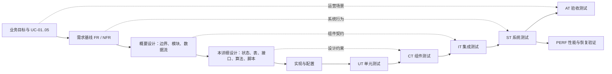
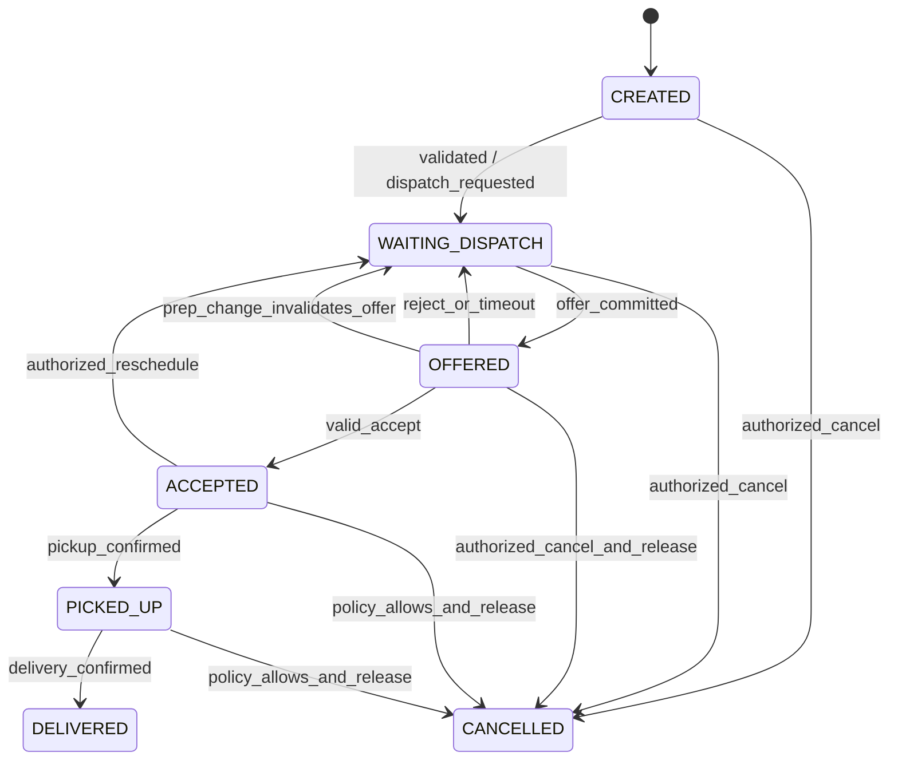
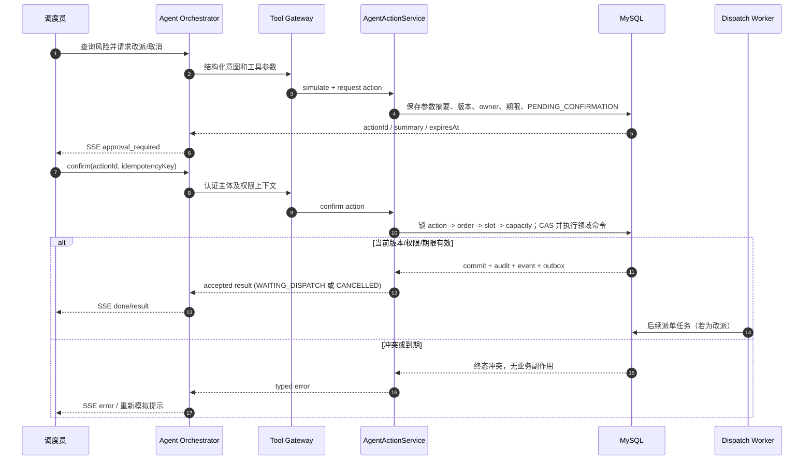

# 峰配调度 Agent（PeakDispatch）详细设计

| 项目 | 内容 |
|---|---|
| 文档类型 | 软件详细设计说明书 |
| 文档版本 | 0.2（演示实现基线） |
| 日期 | 2026-10-08 |
| 状态 | 演示实现基线；Agent 支撑性能已实测，严格生产 SLO 作为后续目标 |
| 需求基线 | `docs/requirements-analysis.md` 0.2 |
| 上位设计 | `docs/overall-design.md` 0.2 |
| 目标读者 | 后端/Agent 开发者、测试人员、运维与评审者 |

## 1. 目的与设计边界

本文将概要设计细化到模块、领域对象、事务边界、表约束、HTTP/事件契约、Redis key/Lua 伪契约、Agent 工具及 V 模型测试用例。实现人员可据此建立工程、编写迁移脚本和接口定义；测试人员可据此准备夹具、故障注入和可追踪的测试报告。

本文不是可直接执行的数据库迁移或应用代码。设计值是可覆盖的演示默认值；性能验收采用 `agent-support-baseline-v1`，严格生产派单 SLO 作为后续优化目标。本文不定义生产平台接入、支付结算、真实导航或 LLM 实时派单。

**设计基线**

- Java 21、Spring Boot 3.5.x、Spring AI 兼容稳定版本、MySQL 8.4 LTS、Redis 7.x、Elasticsearch；Spring AI 与 Redis 客户端补丁版本在工程初始化时锁定并验证。
- MySQL 保存订单、分配、容量账本、运行状态、审批和审计的权威事实；Redis 保存可重建索引、短租约、流、延迟任务与限流状态。
- 每单实时派单由确定性调度器处理。Agent 只经 allowlist 工具调用查询、诊断、模拟、检索和受控命令。
- 消息至少一次；使用事务 Outbox、Consumer Inbox、CAS、唯一约束和幂等键保证业务效果至多一次。
- 演示默认单区域、顺序单骑手 Offer、容量按并行订单数计算且上限为 3；Offer TTL 为 30 秒，每单最多 5 轮，退避为 5/15/30/60 秒后转运营队列。其余演示值见第 17 节。
- MVP 为模块化单体制品，API 与 Worker 可用不同运行角色独立部署。

**范围边界**：演示只覆盖一个运营区域，不做跨区派单；使用确定性 mock 模型和模拟路线，不接生产身份、模型或地图服务。生产高可用和生产级 RPO/RTO 不在本基线内。后续变更需同步更新本文、需求追踪和测试用例。

## 2. V 模型位置与追踪规则



需求 ID 是追踪主键，不更名、不重编号。本设计用例 ID 为建议编号：`UT-*`、`CT-*`、`IT-*`、`ST-*`、`AT-*`、`PERF-*`。实际执行时需关联需求 ID、代码提交/构建版本、测试数据种子、环境信息和报告位置。测试结果未运行前不能标为通过。

## 3. 模块、包与调用边界

### 3.1 建议包结构

包名仅为详细设计建议，按 Java 领域边界组织；不要求逐字匹配任何参考项目。

```text
com.peakdispatch
  api
    order / merchant / courier / operations / agent
    auth / error / idempotency / sse
  application
    order / merchant / courier / dispatch / operations / agent / knowledge
  domain
    order / merchant / courier / dispatch / policy / approval / agent / knowledge
    shared (Clock、DomainEvent、BusinessError 等)
  port
    repository / event / geo / lease / route / model / knowledge / audit
  adapter
    mysql / redis / elasticsearch / model / route / metrics
  worker
    outbox / lifecycle / dispatch / timeout / reconciliation / knowledge
  config
    security / serialization / observability / runtime-role
```

依赖方向为 `api/worker → application → domain + port`，`adapter` 实现 port。领域对象不得引用 Spring、Redis 或模型 SDK。API 与 Worker 调用同一应用服务，不复制迁移规则。事务入口放在 application service；跨 MySQL/Redis 的操作明确为两个步骤，以 Outbox、短租约和补偿连接，不使用虚假的分布式事务。

### 3.2 关键类与职责

| 类/接口 | 职责与关键方法 | 禁止承担的职责 |
|---|---|---|
| `OrderController` | DTO/认证上下文转换；调用 `OrderApplicationService`；输出统一响应 | 状态迁移、DAO 调用、派单评分 |
| `OrderApplicationService` | `createOrder`、`getOrder`、`cancelOrder`；事务、幂等协调 | 直接操作 Redis key |
| `OrderTransitionPolicy` | `canTransition(from,to,command,context)`；检查合法状态转换 | 网络/持久化调用 |
| `DeliveryOrder` | 订单状态、版本和影响调度的事实字段；执行受保护的领域行为 | 接受模型自由文本作为状态 |
| `MerchantApplicationService` | 备餐 ETA/完成命令；写事件并触发重评估 Outbox | 更新 Redis GEO |
| `CourierPresenceService` | 上下线和心跳校验；维护在线域状态与位置索引端口 | 将心跳索引视为订单事实 |
| `DispatchCoordinator` | 读取订单快照、候选、策略；调用确定性决策器和容量租约端口；创建 Offer | 调用 LLM、绕过订单 CAS |
| `CandidateFilter` | 处理在线、心跳、区域、容量和时限硬约束，返回排除原因 | 写入订单状态 |
| `CandidateScorer` | 归一化策略特征、计算分数、稳定排序和解释 | 访问 Redis/DB 或随机打分 |
| `DispatchRepository` | 事务内读取/锁定订单、slot、容量行并保存 Offer/事件/Outbox | Redis 读写 |
| `CapacityLeasePort` | rider-scoped 预占、确认、释放和容量派生同步 | 作为最终容量权威 |
| `OfferResponseService` | 接单/拒单命令；校验 token、期限、版本，执行 DB CAS 和 Outbox | 依赖客户端时间决定有效性 |
| `OfferTimeoutWorker` | 认领到期任务；查 DB 后幂等过期/重派 | 仅按 ZSet 数据直接改状态 |
| `OutboxPublisher` | DB claim、Redis `XADD`、发布标记、有限重试 | 对失败事件静默删除 |
| `StreamConsumer` | 解析 envelope、处理 Inbox claim、调用应用服务、按提交结果 ACK | 把 ACK 当作业务提交 |
| `DispatchRecoveryScanner` | 重建缺失派单请求、延迟任务和容量派生状态 | 反复无条件增加 retry/round |
| `AgentOrchestrator` | run 生命周期、意图/槽位、模型调用、工具调用、事件持久化和恢复 | Repository/Redis 直连 |
| `ToolGateway` | allowlist、Schema、主体/区域授权、限流、脱敏、审计、错误映射 | 接收模型提供的 user/role 权限 |
| `OpsToolService` | 只读指标、订单诊断、调度模拟和操作请求用例 | 返回未经授权的跨区域数据 |
| `AgentActionService` | 创建/拒绝/确认持久化动作；事务调用领域命令 | 把“请求已排队”表述为“骑手已接单” |
| `AgentRunResumer` | 消费 `agent.action.resolved`，按 checkpoint 恢复等待中的 run 并生成最终消息 | 重放工具写命令或绕过 action 幂等 |
| `SopSearchService` | Elasticsearch 检索、区域过滤和引用组装 | 将 SOP 文本用作业务授权 |
| `AuditRecorder` | 追加权限、策略、Agent 工具和业务操作审计 | 写入凭证/完整敏感提示 |

### 3.3 API 与 Worker 运行角色

单一制品用运行角色启动：`API`、`WORKER` 或 `ALL`（仅本地单进程演示）。生产/压测建议 API 与 Worker 分开部署，使用同一代码和契约。Worker 内有独立并发池：Outbox、生命周期事件、派单、超时、对账、知识索引任务分别设置并发和关闭等待时间。关闭时停止领取新消息，等待正在处理的 DB 事务完成；超时未完成消息不 ACK，由 Pending 恢复。

## 4. 领域模型与状态迁移

### 4.1 值对象、实体与枚举

| 对象 | 关键字段/语义 | 不变量 |
|---|---|---|
| `DeliveryOrder` | `orderId, merchantId, regionId, pickup, dropoff, prepEta, deadline, status, version, dispatchRound, nextDispatchAt` | 时间有序；状态迁移合法；订单版本单调递增 |
| `CourierSnapshot` | `courierId, regionId, dbOnline, dbPresenceGeneration, redisPresenceGeneration, sequence, lastHeartbeatAt, location, capacityLimit, committed, reserved, indexedPresenceVersion` | `presenceVersion=(redisPresenceGeneration,sequence)`；评分要求 DB 在线/代次、Redis presence 与区域索引版本一致；预占后 MySQL 再锁行复核代次；DB capacity 行最终裁决 |
| `DispatchPolicySnapshot` | `policyId, version, regionId, limits, featureWeights, retryPolicy` | 创建派单决策后记录所用版本和输入快照 |
| `DispatchOffer` | `offerId, orderId, courierId, courierPresenceGeneration, round, tokenHash, status, expiresAt, orderVersion, scoreDetail` | 同订单一个活动 slot；保存创建时骑手会话代次；token 只允许使用一次 |
| `DispatchSlot` | `orderId, phase, currentOfferId?, courierId?, version` | 每个订单创建时初始化一行；phase=`IDLE/OFFERED/ASSIGNED/CLOSED`；后两者表示活动分配 |
| `DispatchAttempt` | `attemptId, orderId, round, outcome, policyVersion, candidateSummary, traceId` | 每个调度轮次记录一次；诊断的失败原因与可复现依据 |
| `CandidateDecision` | `attemptId, courierId, eligible, reasonCode, rank, score, features` | 受限数量候选的可追溯筛选/评分快照 |
| `DispatchAssignment` | 被接受后的骑手分配历史、接单/释放时间和结束原因 | 每个订单至多一条当前有效 assignment，由 slot 行仲裁 |
| `CapacityLedger` | `courierId, committedCount, reservedCount, version` | 计数不小于零且总和不超过 limit |
| `AgentRun` | `runId, sessionId, ownerId, status, intent, checkpoint, lastSequence` | 终态不回到运行态，事件序号单调递增 |
| `AgentAction` | 规范化动作、目标/版本、摘要 hash、申请人、确认人、期限、幂等键 | 确认仅对同摘要、同版本和授权主体有效 |
| `Citation` | `documentId, version, chunkId, section, title, URI, excerpt` | 引用必须来自实际检索 chunk |

状态在 Java 中使用枚举/受限值对象；数据库用 `VARCHAR` 存储，避免依赖 DB ENUM 的迁移行为。外部 API 使用规范化大写状态值。时间由注入的 `Clock` 提供，业务时刻统一 UTC，期限校验使用数据库时间或受控服务时钟，不接受客户端时间覆盖服务时间。

### 4.2 订单状态机



| 当前状态 | 命令/事件 | 前置条件 | 结果与副作用 | 失败分类 |
|---|---|---|---|---|
| `CREATED` | 校验完成/`order.created` | 必填字段有效，商家可服务 | 转 `WAITING_DISPATCH`；设 `dispatchRound=1,nextDispatchAt`；写事件和派单 Outbox | `ORDER_INVALID`、`MERCHANT_UNAVAILABLE` |
| `WAITING_DISPATCH` | `CreateOffer` | 订单版本匹配、无活动 slot、候选和容量有效 | 事务写 Offer、slot=`OFFERED`、reserved+1、订单转 `OFFERED`、事件/Outbox | `VERSION_CONFLICT`、`NO_CAPACITY` |
| `OFFERED` | `AcceptOffer` | 活动 offer/token 相同、DB 当前时间早于到期、订单版本匹配 | Offer 接受；slot=`ASSIGNED`；reserved-1/committed+1；订单 `ACCEPTED` | `OFFER_EXPIRED`、`OFFER_SUPERSEDED` |
| `OFFERED` | `RejectOffer`/超时/备餐更新使 Offer 失效 | 活动 slot 指向该 Offer；拒单主体有效、已到期或 ETA 更新触发策略失效 | Offer 终结为相应状态；slot=`IDLE`；reserved-1；订单回 `WAITING_DISPATCH` 并写下一轮 Outbox | 重复命令返回已处理结果 |
| `ACCEPTED` | `ConfirmPickup` | 分配骑手匹配，未取消/未取餐 | 转 `PICKED_UP`；写事件 | `INVALID_TRANSITION` |
| `PICKED_UP` | `ConfirmDelivery` | 骑手匹配，未送达 | 转 `DELIVERED`；关闭 slot/assignment；committed-1 | `INVALID_TRANSITION` |
| 未完成状态 | `RequestReschedule` | 权限、版本、状态和策略允许 | 关闭原 Offer/assignment；释放 reserved 或 committed；转 `WAITING_DISPATCH`；写新的 dispatch Outbox | `FORBIDDEN`、`VERSION_CONFLICT` |
| 未完成状态 | `CancelOrder` | 角色和 CancellationPolicy 允许 | 释放活动 Offer/assignment；slot=`CLOSED`；转 `CANCELLED` | `CANCEL_NOT_ALLOWED` |

**创建事件闭环**：`POST /orders` 在事务中创建 `CREATED` 订单、初始事件、幂等记录和 `order.created` Outbox。生命周期消费者在单一 DB 事务中把有效订单从 `CREATED` 改为 `WAITING_DISPATCH`，设定下一调度时间并写 `order.dispatch_requested` Outbox；之后派单 Worker 才运行候选算法。消费者/扫描器重复执行均由 order version 和 event Inbox 保证幂等。恢复扫描同时覆盖过期 `CREATED` 和没有活动 Offer 的过期 `WAITING_DISPATCH`。

### 4.3 Offer、运力和审批状态

`DispatchOffer` 状态：`OFFERED → ACCEPTED | REJECTED | EXPIRED | SUPERSEDED`。终态不可再次改变。Offer token 原文仅在骑手通知/响应中短暂使用；MySQL 保存 hash 和短期加密密文，Redis lease 保存 hash。每次新 round 生成新 offerId 和随机 token，旧轮 token 永不复用。拒单、超时、商家 ETA 变更等导致失效时，slot 回到 `IDLE`；改派/取消/送达后 slot 为 `CLOSED`。

为支持通知失败重试，`token_ciphertext` 使用服务端密钥管理提供的信封加密；Outbox 只保存 `offerId/tokenRef`，通知适配器按活动 Offer 读取并解密后发送，禁止把明文 token 写进 Stream、普通日志或审计。服务端用 `token_hash` 校验响应。Offer 终结/过期后按安全策略销毁密文，仅保留 hash 和审计元数据。

容量账本转换只在 MySQL 事务内发生：

| 业务动作 | `reserved_count` | `committed_count` | 条件 |
|---|---:|---:|---|
| 创建 Offer | +1 | 0 | 条件检查总数小于 limit |
| 骑手接受 Offer | -1 | +1 | 活动 Offer/token/期限正确 |
| 拒单或超时 | -1 | 0 | Offer 尚处于 `OFFERED` |
| Offer 状态取消 | -1 | 0 | slot 当前仍指向该 Offer |
| 已接单任务送达 | 0 | -1 | assignment 当前有效 |
| 已接单任务改派/取消 | 0 | -1 | 改派/取消规则允许且 slot 匹配 |

所有转换先核验目标计数不会为负；违反表示重复事件或账本偏差，写告警审计并拒绝静默修正。Redis 计数以同一个 offerId/eventId 做幂等投影，无法替代上述 DB 检查。

AgentRun 与 AgentAction 是两台独立状态机。`AgentRun`：`RUNNING → WAITING_CONFIRMATION → RUNNING → COMPLETED | FAILED | CANCELLED`；`AgentAction`：`PENDING_CONFIRMATION → CLAIMED → COMPLETED | FAILED`，或 `PENDING_CONFIRMATION → REJECTED | EXPIRED | INVALIDATED`。每种 Action 终态都在同一 MySQL 事务写入 `agent.action.resolved` Outbox（含 actionId、outcome、runId）；重复处理由 eventId/toolCallKey 去重。RunResumer 消费该事件，只有 Action 仍匹配 Run checkpoint 时才恢复 Run，按结果生成面向用户的答复并结束或继续；不得重新执行原写工具。所有迁移 CAS，过期扫描只依据数据库期限。

## 5. 确定性调度算法

### 5.1 输入快照与候选筛选

输入结构 `DispatchInput` 至少包括：订单 ID/版本/区域/取送坐标/出餐 ETA/截止时间、候选策略 ID/version、评估时刻、候选上限及规则配置。候选粗筛通过区域 GEO 查询，按附近服务区策略并集去重；候选快照再读取 rider-scoped presence、Redis capacity 派生值和必要 DB 骑手容量行。评分前必须确认区域索引版本 `(generation,sequence)` 与当前 rider presence 一致；区域、在线态或版本不一致的候选不得使用其 GEO 坐标计算 ETA。超过最大候选数时按有效 GEO 距离排序截断，配置与实际候选数写入诊断记录。

硬过滤顺序固定并记录首个失败原因：

1. 骑手 ID、区域和位置字段有效；候选在策略允许的服务区/最大接驾距离内。
2. DB `courier.online_state=ONLINE` 且 `dbPresenceGeneration` 等于 rider presence 的 generation；presence 为在线且 `now - lastHeartbeatAt ≤ heartbeatTimeout`。候选必须带 GEO 同槽版本 Hash 的 `(generation,sequence)`，评分前与 rider presence 当前版本及 region 比较一致。Lua 在预占时再次校验这两个值，MySQL 派单事务锁 courier 行再核对 generation，覆盖跨存储更新竞态。
3. 读取 rider 的 DB capacity `version/limit/committed/reserved`；Redis `ready=1` 且投影 version 与 DB version 一致。Lua 校验同一预期 version；负载按 Redis `committed + reserved` 判断，其中 reserved 包含 provisional lease。版本不一致时先刷新/重建，不能按空缓存派单。
4. 路线估算可用，按 `arrivalMerchant = now + etaToMerchant`、`pickupAt = max(arrivalMerchant, prepEta) + pickupServiceTime`、`deliveryAt = pickupAt + etaMerchantToDropoff` 估算。
5. `deliveryAt ≤ deadline`；硬约束失败的候选不参与评分。缺关键 ETA 时由策略规定拒绝或标为不可派，不调用模型补值。

预测使用 `RouteEstimator` port。演示实现固定为 `haversineDistance × 1.3` 的模拟路程、20 km/h 行驶速度和每个停靠点 2 分钟服务时间，输出米数、毫秒 ETA 和 `estimatorVersion=demo-haversine-v1`。该 ETA 仅供仿真比较，不代表真实路况。外部地图适配器将来替换该 port，不改变调度规则契约。

### 5.2 评分、稳定排序与决策解释

对通过硬约束的候选计算归一化特征，范围/截断阈值存于不可变策略版本：

| 特征 | 方向 | 定义 |
|---|---|---|
| `pickupEtaNorm` | 越小越好 | 接驾 ETA 按策略最大范围归一化并截断到 `[0,1]` |
| `merchantWaitNorm` | 越小越好 | `max(0, prepEta-arrivalMerchant)` 按最大等餐时间归一化 |
| `urgencyPenaltyNorm` | 越小越好 | 预计送达剩余 slack 越少，惩罚越高；已超时候选已由硬过滤排除 |
| `loadRatioNorm` | 越小越好 | `(committed+reserved)/capacityLimit` |
| `zonePenaltyNorm` | 越小越好 | 相邻服务区/跨区代价，若策略不允许则硬过滤 |

```text
score = wEta*pickupEtaNorm
      + wWait*merchantWaitNorm
      + wUrgency*urgencyPenaltyNorm
      + wLoad*loadRatioNorm
      + wZone*zonePenaltyNorm
```

所有权重为非负配置，策略发布时校验归一化范围和权重和；候选以 `(score ASC, estimatedDelivery ASC, courierId ASC)` 稳定排序。相同输入快照、估算器版本和策略版本必须产生相同顺序。`DispatchDecision` 保存策略版本、估算器版本、输入摘要、每个候选特征/分数/淘汰原因和选中理由，避免仅存一个不可解释的总分。

### 5.3 多单拼单预览

`simulateBundles` 是只读纯函数服务：输入订单 ID 集、区域、策略版本和容量快照；先排序规范化输入，再验证订单未终态、取餐/送达点完整、可在同一可服务范围内处理。对受配置上限约束的订单集合生成确定性插入顺序候选；每个路线均检查取餐先于送达、骑手容量、每单送达期限及取送顺序。路线估算器计算预计路线、总距离、逐单 ETA 与时效裕量。结果按硬约束通过、总时长/风险评分和稳定订单序列排序。

演示预览最多包含 3 单且仅同一区域订单。对 `2N` 个取送停靠点枚举顺序，过滤取餐先于对应送达的顺序，再以固定路线估算器验证容量、备餐时间和每单 deadline，返回可行方案中总估算时间最短者；并列时按订单 ID 与停靠序列稳定排序。骑手现有 `committed + reserved + N` 不得超过容量上限。返回 `simulationId, inputVersions, policyVersion, routeEstimatorVersion, candidates[], rejectedConstraints[]`。预览不申请 Redis lease、不写订单状态、不预占容量；超过 3 单返回 `SIMULATION_LIMIT_EXCEEDED`，不静默截断。此枚举预览不是全局最优求解器，后续规模增加再评估 OR-Tools。

## 6. MySQL 详细持久化设计

### 6.1 列和类型约定

- 主键/外部实体 ID 建议用 UUID 的 `BINARY(16)` 存储，API 转换为标准 UUID 字符串；选择具体 UUID 生成策略属于工程初始化决定。
- 时间列采用 `DATETIME(3)` 并规定连接 session 使用 UTC；API 输入/输出为带时区 ISO-8601。数据库 `UTC_TIMESTAMP(3)` 用于期限最终校验。
- 订单/骑手状态使用 `VARCHAR(32)`；应用枚举校验，迁移可向前扩展。版本、sequence、计数用非负 BIGINT/INT；业务代码仍做范围校验。
- 位置保存经纬度 `DECIMAL(9,6)` 或等精度数值列，地址/电话尽量不存；若仿真需地址，按敏感字段权限和留存策略处理。
- 可查询字段单独列；事件、规则快照和工具结果可用 JSON，但不将 JSON 作为高频筛选/唯一约束的替代品。
- 字段清单是逻辑 DDL 设计，索引基数和 MySQL 小版本须在实施时 `EXPLAIN` 与迁移验证。

### 6.2 核心表字段与约束

| 表 | 关键列（建议类型） | 主约束与用途 |
|---|---|---|
| `delivery_order` | `id BINARY(16) PK, merchant_id, region_id, pickup_lat/lon DECIMAL, dropoff_lat/lon DECIMAL, prep_eta DATETIME(3), deadline DATETIME(3), status VARCHAR(32), version BIGINT, dispatch_round INT, next_dispatch_at DATETIME(3), created_at, updated_at` | 索引 `(region_id,status,next_dispatch_at)`、`(merchant_id,status)`；影响调度的字段变更增加版本 |
| `merchant` | `id PK, region_id, active, prep_state, version, avg_prep_seconds, updated_at` | `(region_id,active)`；实际 ETA 以订单备餐更新为准 |
| `courier` | `id PK, region_id, online_state, presence_generation BIGINT, capacity_limit INT, version, last_position_at` | `(region_id,online_state)`；`region_id` 是当前会话服务区域；显式上线/重连/下线时递增 generation；高频坐标可只放 Redis |
| `courier_capacity` | `courier_id PK/FK, committed_count INT, reserved_count INT, version BIGINT, updated_at` | 容量最终仲裁行；`courier_id` 必须唯一 |
| `dispatch_offer` | `id PK, order_id, courier_id, courier_presence_generation, round_no, token_hash, token_ciphertext, status, expires_at, order_version, policy_id, policy_version, estimator_version, score_detail JSON, created_at, updated_at` | `UNIQUE(order_id,round_no)`；`UNIQUE(token_hash)`；索引 `(status,expires_at)`、`(courier_id,status,expires_at)`；记录创建 Offer 时的骑手会话代次；密文只用于通知重试 |
| `dispatch_attempt` | `id PK, order_id, round_no, order_version, policy_id, policy_version, estimator_version, outcome, candidate_count, selected_courier_id NULL, exclusion_summary JSON, started_at, finished_at, trace_id` | `UNIQUE(order_id,round_no)`；索引 `(order_id,started_at)`、`(outcome,finished_at)`；保存有界汇总而非无界日志 |
| `dispatch_candidate_decision` | `attempt_id, courier_id, eligible, reason_code NULL, rank NULL, score NULL, feature_snapshot JSON` | `PRIMARY KEY(attempt_id,courier_id)`；只存策略规定的诊断上限/Top-K 候选；按期限归档清理 |
| `order_dispatch_slot` | `order_id PK, phase VARCHAR(16), offer_id NULL, courier_id NULL, slot_version, updated_at` | 每订单单行；状态为 `IDLE/OFFERED/ASSIGNED/CLOSED`；`OFFERED/ASSIGNED` 表示唯一活动分配。所有更新先锁订单行并更新 slot |
| `dispatch_assignment` | `id PK, order_id, courier_id, offer_id, status, accepted_at, released_at, release_reason, version` | `UNIQUE(offer_id)`；索引 `(courier_id,status)`、`(order_id,released_at)`；当前有效性由 slot 主键确定 |
| `delivery_event` | `event_id PK, aggregate_type, aggregate_id, aggregate_version, event_type, actor_type, actor_id, occurred_at, trace_id, payload JSON` | `event_id` 唯一；索引 `(aggregate_type,aggregate_id,aggregate_version,occurred_at)`；同一版本允许多个语义事件 |
| `outbox_event` | `event_id PK, topic, aggregate_type, aggregate_id, aggregate_version, dedupe_key, payload JSON, created_at, published_at NULL, attempts, next_attempt_at NOT NULL, claim_owner NULL, claim_until NULL` | `UNIQUE(dedupe_key)`；索引 `(published_at,next_attempt_at,created_at)`；不因发布成功删除 |
| `inbox_message` | `consumer_name, event_id, status, claim_owner, claim_until, attempts, processed_at, last_error_code` | `PRIMARY KEY(consumer_name,event_id)`；支持租约 claim 和处理完成去重 |
| `api_idempotency` | `scope, key_hash, request_hash, status, claim_owner, claim_until, response_code, response_json, resource_id, created_at, expires_at` | `PRIMARY KEY(scope,key_hash)`；请求体 hash 不同返回 `IDEMPOTENCY_KEY_REUSED` |
| `dispatch_policy` | `id PK, region_id, version, config_json, status, created_by, created_at, activated_at` | `UNIQUE(region_id,version)`；策略不可原地覆盖；状态包含 DRAFT/ACTIVE/RETIRED |
| `agent_session` | `id PK, owner_id, region_scope JSON, summary_redacted, created_at, updated_at, expires_at` | `(owner_id,updated_at)`；区域范围需服务端授权 |
| `agent_run` | `id PK, session_id, owner_id, status, intent, checkpoint JSON, model_id, prompt_version, started_at, ended_at, last_sequence, token_usage JSON, trace_id` | `(session_id,started_at)`、`(status,updated_at)` |
| `agent_run_event` | `run_id, sequence, event_type, payload_redacted JSON, created_at` | `PRIMARY KEY(run_id,sequence)`；用于 SSE 恢复 |
| `agent_tool_call` | `id PK, run_id, tool_call_key, tool_name, args_hash, result_ref, status, duration_ms, error_code, created_at` | `UNIQUE(run_id,tool_call_key)`；不存未脱敏的完整敏感参数 |
| `agent_action` | `id PK, run_id, action_type, target_id, expected_version, params_json, summary_redacted JSON, params_hash, summary_hash, requested_by, confirmed_by, expires_at, status, idempotency_key, result_ref, created_at, updated_at` | `UNIQUE(idempotency_key)`；索引 `(status,expires_at)`、`(target_id,status)`；参数仅含 allowlist 字段，必要时加密 |
| `audit_log` | `id PK, actor_id, action, target_type, target_id, decision, before_version, after_version, trace_id, details_redacted JSON, created_at` | `(target_type,target_id,created_at)`、`(actor_id,created_at)`；应用账号仅 INSERT/SELECT |
| `knowledge_document` | `id PK, external_key, title, version, source_hash, region_scope, status, effective_at, indexed_at, created_at` | `UNIQUE(external_key,version)`；ES 索引可从该表和文档源重建 |

`delivery_event` 使用 eventId 做唯一去重，不限制一个聚合版本只能出现一个事件；一个事务可以记录多个语义事件，查询按聚合 ID、版本和时间排序。业务幂等由 Inbox、命令幂等键和状态 CAS 保证，不依赖事件表复合唯一约束。

### 6.3 当前分配唯一性和条件更新

MySQL 不依赖“部分唯一索引”表达活动 Offer。`order_dispatch_slot` 以 `order_id` 为主键，作为每单唯一活动槽；事务对 `delivery_order` 行 `SELECT ... FOR UPDATE` 后再锁 slot。创建 Offer 要求 slot 为 `IDLE`；插入/更新 offerId、courierId、phase 与订单状态在同一事务提交。拒单/超时清空 Offer/courier 字段并把 phase 置 `IDLE`，接受后 phase=`ASSIGNED`，送达/取消后 phase=`CLOSED`。`dispatch_offer` 保留所有轮次历史。

骑手竞争时事务以固定顺序锁定 `delivery_order → order_dispatch_slot → courier → courier_capacity → dispatch_offer`，多个订单/骑手时按 ID 排序。创建 Offer 前复核 `courier.online_state=ONLINE` 且 DB `presence_generation` 等于候选版本中的 generation，并把该 generation 写入 Offer；不匹配则回滚并释放 provisional lease。容量更新条件为 `committed_count + reserved_count < capacity_limit`，成功后增加 reserved 并增加 capacity version；条件失败回滚整个 Offer 事务。接受时同事务按相同顺序复核骑手仍在线且 generation 等于 Offer 保存值，再执行 reserved--、committed++；会话已变化则将 Offer 以 `COURIER_SESSION_CHANGED` 原因失效、释放 reserved 并推进重派。拒绝/超时等仅允许对仍活动的 Offer 转换一次。若更新行数为 0，重新读取订单和 Offer 再返回冲突，不在事务外盲目重试写操作。上线/下线命令只锁 courier，不再反向获取订单或容量锁。

### 6.4 幂等、Outbox 与 Inbox 事务

**HTTP 幂等**：服务端将 `scope + Idempotency-Key` 做 hash 存储；先插入占位/处理中记录，业务结果和幂等响应在同一事务落库。并发同键请求由唯一约束串行化：同 request hash 返回已提交响应；不同 hash 返回 409；执行中请求返回可重试冲突或等待有限时间。TTL 清理不早于客户端约定重试窗口，过期清理不影响业务事实。

**Outbox 发布**：Publisher 在短事务中 claim `published_at IS NULL AND next_attempt_at <= now AND (claim_until IS NULL OR claim_until < now)` 行，设置 claim owner/deadline；事务外对 Redis Stream `XADD`，字段至少含 `eventId,eventType,schemaVersion,aggregateId,aggregateVersion,payload`；成功后用 claim owner 条件更新 `published_at`。若 XADD 成功而更新失败，重复 XADD 同 eventId；消费端去重。发布异常只更新 attempts/next attempt，不清 payload。达到策略上限告警/DLQ 记录，Outbox 行留存供人工恢复。

**Inbox 消费**：消费者尝试 claim `(consumerName,eventId)`。已 `PROCESSED` 立即 ACK；仍在有效 claim 的消息不并行执行；claim 过期可由 `XAUTOCLAIM` 后续持有者接管。业务应用事务中锁定聚合行，校验 aggregateVersion/状态，写业务事实、事件、Outbox，并将 Inbox 标为 `PROCESSED`。DB commit 后才 `XACK`。DB 回滚时 Inbox 不得标完成，消息可恢复；DB commit 后进程在 ACK 前崩溃，重放只 ACK，不重复业务效果。

## 7. Redis 详细设计

### 7.1 命名空间和 Key

key 中环境名是普通前缀，不加 Redis hash-tag 花括号；花括号只用于实际 Cluster 同槽标记。`<env>`、`<regionId>`、`<courierId>` 是命名模板占位符，不是 key 字面字符。

| Key 模板 | 类型/字段 | 初始化与生命周期 |
|---|---|---|
| `pd:<env>:stream:dispatch` | Stream | XADD 只由 Outbox 发布；Consumer Group `dispatch-v1` |
| `pd:<env>:stream:lifecycle` | Stream | 商家/订单/骑手关键事件；group `lifecycle-v1` |
| `pd:<env>:stream:dlq:<topic>` | Stream | Outbox 最大重试后错误摘要、eventId、payload hash、traceId |
| `pd:<env>:stream:dlq:consumer:{<env>-consumer-dlq}` | Stream | Consumer DLQ；与 `:dedupe` Hash 同槽，按 sourceStream/sourceRecordId 幂等 XADD |
| `pd:<env>:geo:{<env>:<regionId>}:members` | GEO/ZSET | riderId 为 member；只做附近候选粗筛；逐成员清除 |
| `pd:<env>:geo:{<env>:<regionId>}:versions` | Hash | field=riderId，value=`<generation>:<sequence>`；也可保存 `<generation>:0` 删除 fence tombstone；按两个非负整数比较；和该区域 GEO key 同槽 |
| `pd:<env>:heartbeat:{<env>:<regionId>}:members` | ZSET | score=lastHeartbeatEpochMs；和该区域 GEO/版本 key 同槽，逐成员清理 |
| `pd:<env>:courier:{<env>:<courierId>}:presence` | Hash | `online,lastHeartbeatMs,presenceGeneration,sequence,regionId`；版本由 generation/sequence 组成；TTL 120 秒，缺失即不可派且心跳须先重新上线 |
| `pd:<env>:courier:{<env>:<courierId>}:capacity` | Hash | `limit,committed,reserved,version,ready`；reserved 同时计 provisional 与 DB Offer；有活动 DB 分配时不可独立过期 |
| `pd:<env>:courier:{<env>:<courierId>}:leases` | Hash | offerId → tokenHash/status/expiry/capacityVersion |
| `pd:<env>:courier:{<env>:<courierId>}:lease-expiry` | ZSET | score=lease expiry，member=offerId；与同骑手 Lua 同槽 |
| `pd:<env>:courier:{<env>:<courierId>}:applied-events` | Hash | eventId → capacityVersion/transition，用于诊断去重；计数正确性以 version 水位和 lease 状态为准 |
| `pd:<env>:offers:{<env>-offers}:due` | ZSET | 到期 offerId；与其他 offers 键同槽 |
| `pd:<env>:offers:{<env>-offers}:claims` | ZSET | claim deadline；租约到期可被其他 Worker 接管 |
| `pd:<env>:offers:{<env>-offers}:payload` | Hash | offerId → dueAt epoch ms；DB 才是到期状态依据 |
| `pd:<env>:offers:{<env>-offers}:claim-owners` | Hash | offerId → fencing token，阻止过期 owner 完成/释放新 claim |
| `pd:<env>:delay:{<env>-reconcile}:due` | ZSET | 对账/索引重建调度候选；数据库可恢复来源 |
| `pd:<env>:idem:<scope>:<keyHash>` | String/Hash | 快速去重提示；MySQL 幂等行为权威 |
| `pd:<env>:limit:<dimension>:<id>` | Hash/String | Lua 固定窗口/令牌桶；窗口结束后 TTL 清理 |

环境名始终是普通 key 前缀 `pd:<env>:`，不得写成 `pd:{<env>}:`，否则 Redis 会把相同环境下的所有 key 放进同一 slot。骑手容量、lease、presence、applied-events 使用 `{<env>:<courierId>}`；区域 GEO、版本 Hash 和 heartbeat ZSet 使用 `{<env>:<regionId>}`；延迟 Offer 队列使用 `{<env>-offers}`；Consumer DLQ Stream 和去重 Hash 使用 `{<env>-consumer-dlq}`。示例骑手 key 为 `pd:demo:courier:{demo:c-17}:capacity`，示例区域 key 为 `pd:demo:geo:{demo:r-1}:members`。脚本的全部 `KEYS[]` 必须来自同一类实体且 hash slot 相同；订单 key、区域索引、全局 Stream 不得和骑手 key 一起传入 Lua。Cluster 合约测试对骑手、区域、Offer 队列和 DLQ 键逐项执行 `CLUSTER KEYSLOT` 并运行所有 Lua 脚本；CRC16 单测不能替代真实 Cluster 检查。`capacity.version` 是 MySQL `courier_capacity.version` 的 Redis 投影水位；`reserved` 包含 provisional lease 和 DB 已创建但未接受的活动 Offer，`committed` 对应 DB 已接受未完成分配。环境前缀只做命名隔离，权限仍由 Redis ACL/独立实例控制。

### 7.2 心跳与 GEO 双索引

每次明确上线/重连或下线都在 MySQL 锁定 courier 行并递增 `presence_generation`；代次在 DB 持久化，不随 Redis TTL 清除。会话变化与 `courier.presence_changed` Outbox 同事务提交。上线请求写入当前 `region_id`；请求提交后调用幂等 `startCourierPresence` 初始化 Redis `presence`（`online=1,sequence=0,regionId`，尚无坐标/心跳时间），投影成功后才返回 `presenceGeneration` 和首个可用序号 1；Redis 不可用时返回可重试错误，重复同一幂等请求会重试投影而不再递增代次。Outbox 消费者重放时先对照 MySQL 当前在线状态/代次，过期事件不应用；Lua 对低代次事件 no-op，对相同代次只幂等确认、不重置 sequence。下线先在 DB 增代并置 offline，再投影 offline、安排区域索引清理，并由 `courier.presence_changed` 的异步补偿任务按事件中的旧区域查找旧活动 Offer，逐个按 `order → order_dispatch_slot → courier → courier_capacity → dispatch_offer` 锁序 CAS 为 `COURIER_SESSION_CHANGED`、释放 reserved 并推进重派；补偿重复执行无副作用，新会话 Offer 不受旧事件影响。重连/切区的投影顺序为先按旧 generation 调用 `stopCourierPresence`（缺失视为幂等成功），再调用新 generation 的 `startCourierPresence`；旧会话清理未确认前不得向客户端报告新会话可用。区域索引删除还必须保留代次 fence，阻止已接受但延迟执行的旧心跳索引写在清理之后复活。

每个心跳携带 `presenceGeneration,sequence,regionId,lat,lon` 作为单一快照。API 开启 MySQL 事务并 `SELECT ... FOR UPDATE` 锁住 courier 行，校验仍在线、DB generation 和当前 `region_id` 匹配，然后调用 Presence Lua；Redis 成功后提交只读 DB 事务并释放行锁，再异步写区域索引。这样上线/下线/重连与心跳通过同一行锁串行化：心跳先取得锁则先写当前会话，切换随后递增代次；切换先提交则旧心跳读到新状态/代次并拒绝。Presence Lua 还要求 key 已存在、online=1、generation 匹配且 sequence 严格大于当前值；接受后更新时间并形成 `presenceVersion=(presenceGeneration,sequence)`。首个 sequence 为 1。key 不存在、代次不匹配或 sequence 重复/较旧时拒绝；心跳不得自行初始化会话，Redis presence 丢失/TTL 到期后须显式重连取得新 generation。区域索引异步写失败可造成漏候选，不可放宽版本检查。

接受的心跳随后调用区域索引 Lua 更新 GEO、`versions` Hash 和 heartbeat ZSet。版本 Hash 保存 `generation,sequence`，Lua 按 generation 优先、sequence 次之做数值比较，仅接受更大版本并一起写入三个索引；旧会话索引写入不能覆盖新会话坐标。相同/较旧 sequence 不续期或改写任何字段。区域索引写失败只造成候选遗漏；修复任务从当前存在且在线的 rider presence 快照重建。

Presence 与区域索引处于不同 slot，写入不承诺原子一致。候选搜索读取 GEO 坐标及同区域 `versions`，每个候选携带 `indexedPresenceVersion=(generation,sequence)`；评分前要求 DB 在线且 `dbPresenceGeneration` 等于 Redis presence generation，同时要求索引版本、presence 版本和区域完全一致。`reserveCourierLease` 再要求候选版本仍与 presence 完全相等且 region 匹配，以覆盖读取后的坐标竞态；其后 MySQL 派单事务锁 courier 行，再次核验在线状态与 generation 并把 generation 存入 Offer。任一版本落后或切区候选均拒绝并重查，不能用旧位置完成有效 ETA 或预占。接单事务再次核验 Offer 代次；会话已变化时失效 Offer 并释放容量。区域切换留下的旧索引只会成为待过滤候选，清理任务随后删除。索引写失败允许候选遗漏，不允许降级成“使用旧坐标派单”；修复任务从当前有效 presence 快照重建，仍用复合版本比较防止覆盖更新。`GEOSEARCH` 结果始终只是候选，不是许可。演示心跳过期阈值为 90 秒，presence TTL 为 120 秒；过期成员由 worker 分批清理，不删除整个 GEO key。

**Presence Lua 伪契约**：上线投影使用 `startCourierPresence`，只接收 `KEYS=[presence]`（同一 courier tag），`ARGV=[generation,regionId]`。key 不存在时写入 `online=1,presenceGeneration=generation,sequence=0,regionId=regionId`，不写坐标/心跳时间，设置 120 秒 TTL；相同 generation、online 和 region 重放返回 `ALREADY_STARTED`，较低 generation 返回 `STALE_GENERATION`，更高 generation 或不同区域返回 `SESSION_CONFLICT`，不得覆盖当前会话。下线投影使用 `stopCourierPresence`，同样只接收 `KEYS=[presence]`，`ARGV=[expectedGeneration]`：key 不存在返回 `ALREADY_STOPPED`；当前 generation 小于或等于 expected 时删除 presence key 并返回 `STOPPED`；当前 generation 更大时返回 `STALE_SESSION`，不得删除新会话。两个脚本不访问 MySQL、区域 key 或 Stream，Outbox 重放可安全调用。心跳使用 `updateCourierPresence`：只接收 `KEYS=[presence]`，全部 rider key 使用同一 courier tag；`ARGV=[expectedGeneration,sequence,regionId,lat,lon]`。调用方须在持有 MySQL courier 行锁、校验 DB 在线状态/代次/区域后调用。脚本拒绝缺 key、`online!=1`、generation 不相等、sequence 非正或不严格大于当前值、非法坐标和非法区域标识；使用 Redis `TIME` 写入 `lastHeartbeatMs`，保存 generation/sequence/region/坐标并刷新 120 秒 TTL。成功返回 `OK,acceptedAtMs,generation,sequence`；重复/旧序号返回 `STALE_SEQUENCE`，代次或 key 不匹配返回 `PRESENCE_SESSION_REQUIRED`，不改变任何字段。脚本不访问 MySQL、区域 key 或 Stream。若脚本失败，回滚/结束只读 DB 事务并返回可重试错误；不得写区域索引或确认心跳成功。

**区域索引 Lua 伪契约**：`updateRegionIndex` 只接收 `KEYS=[geo,versions,heartbeat]`，三个 key 必须使用同一 region tag；`ARGV=[courierId,generation,sequence,lon,lat,acceptedAtMs]`。脚本把版本值按两个非负整数比较，只有 `(generation,sequence)` 大于 Hash 中旧值时才执行 `GEOADD`、写入 `versions` 的 `<generation>:<sequence>` 和 heartbeat ZSet score=`acceptedAtMs`；Hash 中的值可以是索引版本或删除 fence，空字段仅表示从未建索引/未设置 fence。相同/较旧版本返回 `STALE_INDEX`，不得续期或覆盖坐标。`removeRegionIndex` 使用相同三把 `KEYS` 和 `ARGV=[courierId,fenceGeneration]`，fence 定义为 `(fenceGeneration,0)`；仅当现存版本小于或等于 fence 时原子执行 `ZREM geo courierId`、`ZREM heartbeat courierId` 并把 `versions[courierId]` 保留/更新为 fence tombstone，禁止 `HDEL versions`。现存版本更高时返回 `NEWER_INDEX_PRESENT`，不得删除新会话索引。清理任务的 fenceGeneration 取 MySQL 当前持久化 generation，而非猜测旧 sequence；读取 Hash 不是删除前置条件，因此即使旧索引尚未写入，也会先立 fence。重连/切区若当前区域已是新会话位置，高于 fence 的新版本会自然保留。tombstone 在骑手仍可能产生迟到心跳或账户仍有效期间保留；仅在骑手永久停用且确认相关请求/任务已排空后，才允许受控清理。这样迟到的旧 generation `updateRegionIndex` 只能得到 `STALE_INDEX`，不能在删除之后复活成员。两个脚本只返回应用可记录的状态，不把索引成功当作派单许可。区域写入失败、超时或重放由修复任务从 rider presence 快照重建；重建仍执行同一复合版本比较，不能用较旧快照覆盖较新索引。

### 7.3 Lua 脚本契约

脚本需有固定版本号/摘要，部署启动时 `SCRIPT LOAD` 或等价方式加载，使用 EVALSHA 并对 `NOSCRIPT` 有界回退。金额以外的计数均为非负整数。Lua 通过 Redis server `TIME` 取时，不信任应用传入的当前时间；输入中的 policy heartbeat timeout 与 offer TTL 必须先在应用层按策略上限校验。所有脚本需对重复请求、token 不匹配、缺 key 和边界容量有组件测试。

**`reserveCourierLease`**：KEYS=`presence,capacity,leases,lease-expiry`，同一 courier hash slot。ARGV=`offerId,tokenHash,requestedLimit,heartbeatTimeoutMs,leaseTtlMs,expectedRegionId,expectedPresenceGeneration,expectedSequence,expectedCapacityVersion`。候选版本的两个数值必须原样传入，不能在 Reserve 前重读后替换。算法顺序：检查 presence key 存在、online、generation、sequence、心跳时效和 region；要求 `(expectedPresenceGeneration,expectedSequence) == (presence.presenceGeneration,presence.sequence)` 且 `presence.regionId == expectedRegionId`；检查 `capacity.ready`、limit 和 capacity version 与本次 DB 快照一致；若相同 offer lease 已存在且 token 匹配，返回 `ALREADY_RESERVED`；清理有限数量过期 provisional lease 并对每个只减一次 reserved；检查 `committed+reserved < limit`；增加 reserved，写 provisional lease 与过期索引，返回 lease expiry 和 capacity version。sequence 或 generation 不匹配均返回 `PRESENCE_VERSION_STALE` 并重查候选；presence key 缺失返回 `PRESENCE_SESSION_REQUIRED`，不得由候选路径自行重建，须显式上线/重连取得新 generation。其余返回码包括 `OK,ALREADY_RESERVED,OFFLINE,STALE_HEARTBEAT,CAPACITY_NOT_READY,CAPACITY_VERSION_STALE,FULL,VERSION_CHANGED,INVALID_ARGUMENT`。

**`confirmCourierLease`**：作为 `offer.created` 容量投影的专用入口，复用 `applyCapacityEvent` 的 version/snapshot 规则；校验 offerId/token 和 provisional 状态，将 lease 改为 confirmed、期限延至 DB Offer `expiresAt + grace` 并更新 ZSet，不再次增加 reserved。入参含该 DB 事务产生的 `capacityVersion,committedCount,reservedCount,limit` 快照。已 confirmed 且版本相同则幂等成功；无记录/不同 token 返回冲突，触发 DB 对账，不创建新的容量计数。

**`releaseCourierLease`**：用于 MySQL 创建 Offer 事务失败的补偿。仅当 offer lease 仍为 provisional 时按 token 原子 `reserved--`、标记 terminal 并移除 expiry member；若已 confirmed，则 DB 可能已提交，脚本不减 confirmed 计数，返回 `RECONCILE_REQUIRED`。重复释放返回 `ALREADY_RELEASED`。拒单/超时/取消/送达等 DB 已提交转换通过 `applyCapacityEvent` 执行，不能走 provisional 补偿路径。

**`applyCapacityEvent`**：用于 Offer 创建/接受、拒绝、过期、送达和取消等 DB 已提交的容量变化 Outbox。输入含 eventId、offerId、目标转换、DB `capacityVersion` 及该事务提交后的 `committed/reserved/limit` 快照。版本恰为当前水位+1 时，先按 Offer 状态作单调转换，再把 Redis committed 设置为 DB snapshot 的 committed，把 Redis reserved 设置为 DB snapshot 的 reserved 加上其他未过期 provisional lease 数。连续版本保证这些其他 provisional 尚未被此前提交事件计入 DB 快照；Offer 创建事件会将本 offer 从 provisional 改为 confirmed，因此不会重复计数。重复/旧 version 不重复改数；版本有缺口、lease 不存在或计数状态不符时，置 `ready=0` 并安排从 DB 重建，不猜测增量。通知顺序乱序不能倒退 lease 状态。Redis 更新失败不会回滚已提交 DB 事实，Outbox 重试；数据库条件更新仍防止容量超售。

过期清理每次脚本只处理配置上限数量的 due lease，防止 Lua 长时间阻塞 Redis。仅 provisional lease 到期可以直接减少 Redis `reserved`；confirmed lease 到期不单方面减少容量计数，而是提示 OfferTimeoutWorker/对账从 DB 确认超时状态。若 DB 事务后容量事件未同步，capacity version 与 DB 读取不一致会让新 reserve 失败并触发刷新。`capacity.ready=0`/key missing 时脚本拒绝预占，不能将缺失视作零负载。

**投影版本和重建**：每次 MySQL `courier_capacity` 计数变化都在同事务增加 `version` 并写一条容量投影 Outbox，payload 携带 `capacityVersion, committedCount, reservedCount, capacityLimit, offerId, transition`。同骑手 Lua 仅接受连续的下一 version；重复/旧 version 不重复改数，跳号或 lease 状态不匹配时将 `ready=0` 并投递对账任务。对账先暂停新预占，再在一致 DB snapshot 中读取容量行、活动 Offer/assignment 和 version；同槽 Lua 写入 DB committed/reserved 计数、重建活动 lease 状态，并将仍有效且不属于活动 DB Offer 的 provisional lease 数加到 Redis reserved。确认 DB version 在快照后未变化才置 `ready=1`；若变化则重试/保持 not-ready。这样 DB 版本是缓存水位，lease 状态和计数转换保持可恢复。

### 7.4 Streams、Pending 和延迟 Offer

- Stream 启动创建 group 时从 `0-0` 读取未完成历史记录；历史消息由 Inbox 去重。部署前的裁剪策略须保证 Outbox 未消费窗口内记录不会被删除。
- Consumer 每条消息解析 envelope、校验 schemaVersion 和 payload hash，再 claim Inbox。业务处理有限超时；只有 Inbox/领域事务提交才 ACK。
- 恢复器按 `XPENDING` 查看 owner/idle/delivery count；idle 阈值高于已定义 Worker 执行 SLA 与安全余量后使用 `XAUTOCLAIM`，避免抢走仍在处理的慢消息。达到 max delivery 后通过同槽 Lua 按 sourceStream/sourceRecordId 幂等写 DLQ；只有 DLQ XADD 和 Inbox DEAD_LETTER 更新成功后才 ACK。人工 replay 先取得 Inbox lease，XADD 成功后立即释放 replay lease；Inbox 状态防止重复 replay 产生业务副作用。
- Offer 延迟队列的 schedule、claim、complete、release 都用同槽 Lua 原子更新 due、claims、payload 和 claim-owners；旧 fencing token 无法完成或释放新 claim。worker 再查 MySQL `dispatch_offer`、order slot、deadline；有效才做状态 CAS。ZSet 丢失/Redis 恢复时用 DB `status=OFFERED AND expires_at <= now` 重建过期任务。
- DB 恢复扫描周期、队列宽限、最大投递次数、Stream 保留长度均配置化并纳入 `NFR-OBS-001` 指标，不在文档中虚构目标值。

## 8. 应用事务与关键处理伪流程

### 8.1 下单与生命周期事件

`POST /orders` 在 `CreateOrderService` 内：校验 DTO 与角色 → 计算 request hash → 幂等记录 claim → 校验 merchant 可服务 → 生成 UUID → 插入 `delivery_order(CREATED,version=1,dispatch_round=0)` → 创建 `order_dispatch_slot(IDLE)` → 插入 `delivery_event(order.created,aggregateVersion=1)` → 插入 Outbox `order.created`（`dedupe_key=order:<id>:created:v1`）→ 保存幂等响应 → commit。任何字段失败整体 rollback，不留下半个订单。

`OrderCreatedHandler` 在一个事务内锁订单、校验 eventId Inbox claim、仅对 `CREATED` 和预期版本执行 `WAITING_DISPATCH`、设 `dispatch_round=1,next_dispatch_at=now`、写状态事件与 Outbox `order.dispatch_requested(round=1)`、标记 Inbox 完成。若订单已取消或版本已推进，将事件记为 stale/no-op 并 ACK，不能倒退状态。

商家备餐更新由 `MerchantApplicationService` 同步执行并在事务中更新订单 prepEta/ready、订单版本、事件和重评估 Outbox。值未变化时幂等返回，不增加版本。若状态为 `WAITING_DISPATCH`，事务增加调度 round 并按 retry policy 延迟写入新 Outbox，使已发布的旧版本请求失效；若为 `OFFERED`，同事务将活动 Offer 标为 `SUPERSEDED`、slot 置 `IDLE`、reserved 减一、订单回到 `WAITING_DISPATCH`，随后增加 round 并安排下一次评估，旧 token 因 slot/version 检查立即失效。若为 `ACCEPTED/PICKED_UP`，只更新时效风险与事件，不自动改派；风险需通过运营查询/确认处理。取消/送达终态仅记录允许的备餐事件，不重新入队。

调度 round 定义为被分配的尝试序号：初次 `order.dispatch_requested` 使用 round 1；某轮无候选、拒单、Offer 超时、Offer 因备餐变化失效后，事务计算 `nextDispatchAt`，并为下一轮分配 `round+1`，将订单/round/下次时刻写入 Outbox。Publisher 在 `next_attempt_at` 到期后才发该记录。`dispatch_attempt(order_id,round_no)` 与 `dispatch_offer(order_id,round_no)` 共用该轮编号，唯一键保证扫描/重放不创建重复轮次。

演示 retry policy 固定每单最多 5 轮，Offer TTL 为 30 秒。轮次 1 至 4 结束后分别延迟 5、15、30、60 秒进入下一轮；第 5 轮无候选、拒绝或超时后将订单标记为运营待处理并停止自动重派。`nextDispatchAt`、轮次和 policy version 必须与 Outbox 同事务提交；扫描器重放不得重置轮次或缩短退避。

### 8.2 派单与 lease

```text
consume dispatch event
  -> claim Inbox (短租约)
  -> load order/version + policy snapshot
  -> verify WAITING_DISPATCH and no active slot
  -> GEO candidate search; deterministic hard filters and ranking
  -> for candidate in stable order:
       Redis reserveCourierLease (rider slot)
       if lease acquired:
         DB transaction, locks order -> slot -> courier -> courier_capacity -> offer:
           verify expected order version/status/slot
           verify courier is ONLINE and DB presence_generation matches candidate
           verify current DB capacity < limit; increment reserved
           insert dispatch_attempt(outcome=OFFER_CREATED) and bounded candidate snapshots
           insert dispatch_offer; set order_dispatch_slot=OFFERED
           order.status=OFFERED; order.version++
           append delivery_event + outbox offer.created/delay registration
           mark Inbox processed
         commit
         outbox publisher syncs lease and notification
         ACK dispatch stream message
         return
       else continue
  -> if no feasible candidate (not an infrastructure error):
       persist dispatch_attempt(outcome=NO_CANDIDATE) and bounded candidate/exclusion summary
       set next_dispatch_at/backoff and enqueue next round Outbox
       mark Inbox processed; ACK
  -> if Redis/DB/route dependency is unavailable or outcome is uncertain:
       rollback DB work where possible; do not mark Inbox processed or ACK
       leave Pending for bounded retry/claim recovery
```

Redis reserve 和 MySQL 事务不能原子提交。DB 失败时应用尽力以同 token 释放 lease；释放失败依赖 lease TTL/清理和对账。DB commit 成功但 Redis 通知失败时，Outbox 保留并重试；派单 Worker 不把 Redis 确认失败伪装为 offer 未创建，订单仍以 DB `OFFERED` 为准。

无候选不无限忙循环：保存候选数、排除原因、策略版本、下一尝试时刻和 retry count；`next_dispatch_at` 由版本化 retry policy 计算。超过最大轮数转待运营告警/人工队列，是否自动取消必须由运营策略另行确认。

每条 `order.dispatch_requested` 带 expected orderVersion 和 round；Worker 读取后先校验二者仍等于 DB 当前值。过期 round 只记 stale/no-op 并 ACK，不进行候选查询。`DispatchRecoveryScanner` 对队列宽限时间以外仍为 CREATED 的订单调用幂等 lifecycle transition；对过期 WAITING_DISPATCH 订单，须确认无活动 slot、当前 round 无 `dispatch_attempt` 且没有有效待发 Outbox，再锁订单并 CAS 增加 round/version、写新的 recovery Outbox。迟到的旧消息因 version/round 不匹配被安全忽略。

### 8.3 接单、拒单和超时

骑手响应必须同时提供 offerId、token、幂等键、期望 orderVersion。服务端通过 token hash 比较，数据库当前时间判定 `expires_at > UTC_TIMESTAMP(3)`。接受事务锁 order→slot→courier→capacity→offer，核对 offer 仍活动、slot 指向当前 offer、版本匹配、期限有效且骑手在线代次等于 Offer 的 `courier_presence_generation`；完成 `reserved--/committed++`、Offer accepted、slot assigned、assignment 插入、order accepted 和事件/Outbox。代次不匹配时在同一事务将 Offer 以 `COURIER_SESSION_CHANGED` 失效、释放 reserved 并排入下一轮，响应 409。相同 Idempotency-Key 返回原响应；同一 offer 重复但使用新键也读到终态并返回幂等当前结果，不重复加容量。

拒单事务验证 rider 与 offer 匹配；重复拒绝直接返回终态；首次拒绝执行 `reserved--`、Offer=`REJECTED`、slot=`IDLE`、订单回待派、分配下一 round 和 `nextDispatchAt`，并写容量投影、状态事件和延迟发布的 dispatch Outbox。Offer 超时及备餐 ETA 变化导致的 Offer 失效使用相同容量/slot 转换，各自保留不同原因码。过期 ZSet 不可直接触发状态更新。接单与超时并发由订单行锁/版本 CAS 决胜：先提交者生效，后提交者读到终态后 no-op/409。

### 8.4 改派、取消与审批恢复



确认事务首先锁定 action，以免两个确认同时 claim；读取 action target 后按 `action → order → slot → courier → capacity → offer` 固定锁序。普通履约事务按 `order → slot → courier → capacity → offer`，不反向锁 action，避免锁环。权限在确认时重新计算。改派若仅请求新分配，Agent 返回“已进入重新派单”及当前状态，不声称骑手已接单；后续事件通过订单时间线查询。重复确认返回已保存 `result_ref`，不重跑命令。

取消事务由 `CancellationPolicy` 按订单状态、是否取餐、用户角色和配置规则判定。取消 Offer 释放 reserved；取消已接受/取餐订单按规则释放 committed 并写审计原因。批量操作不在 MVP 工具目录，避免单 action 绑定多个版本/部分成功语义不明确。

## 9. HTTP API 契约

### 9.1 公共约定

- `Content-Type: application/json`；时间为带 offset 的 ISO-8601；响应时间统一 UTC。
- 写请求必须有 `Idempotency-Key`（长度/字符集受限），更新命令携带 `expectedVersion`。ETag 可作为响应头镜像版本，但 body version 是必需字段。
- `X-Request-Id` 可由调用端提供作关联提示；服务端生成 `traceId`，不能因调用端 ID 冲突覆盖 trace。
- 认证主体从 JWT/OIDC 或本地演示认证适配器取得；body/query 中的 `userId/role/regionScope` 一律忽略或拒绝。
- 成功结构：`{ "data": ..., "requestId": "..." }`。错误结构：`{ "error": { "code", "message", "retryable", "details?" }, "traceId": "..." }`。

### 9.2 端点与 Schema

| 方法/路径 | 请求关键字段 | 成功结果 | 授权/幂等 |
|---|---|---|---|
| `POST /api/v1/orders` | `merchantId,regionId,pickup,dropoff,prepEta,deadline`; header 幂等键 | `orderId,status=CREATED,version,createdAt` | 仿真下单角色；必须幂等 |
| `GET /api/v1/orders/{id}` | 路径 ID | 订单当前视图、version、活动 Offer 摘要、`asOf` | 区域读权限 |
| `POST /api/v1/merchants/{id}/prep` | `orderId,expectedVersion,prepEta,ready,eventId` | 新版本与重评估状态 | 商家主体绑定 merchantId；eventId 幂等 |
| `PUT /api/v1/couriers/{id}/presence` | `online,regionId?,Idempotency-Key`（online=true 时 regionId 必填） | `presenceGeneration,nextSequence=1`（online 时） | 骑手本人/管理员；MySQL 锁骑手并递增 generation，写 Outbox；Redis 投影成功后返回新会话。online=false 时 regionId 忽略 |
| `POST /api/v1/couriers/{id}/heartbeat` | `lat,lon,regionId,presenceGeneration,sequence,occurredAt` | `accepted,acceptedAt,heartbeatExpiresAt,presenceVersion=(generation,sequence)` | 骑手本人；先查 MySQL 主库在线/代次，再校验所属区域；sequence 在代次内单调、限速；客户端时间只作诊断 |
| `POST /api/v1/couriers/{id}/offers/{offerId}/accept` | `offerToken,expectedVersion` | Offer/订单状态、版本 | offer 绑定骑手主体；幂等键 |
| `POST /api/v1/couriers/{id}/offers/{offerId}/reject` | `offerToken,reasonCode` | Offer 终态、订单是否重新入队 | offer 绑定骑手主体；幂等键 |
| `POST /api/v1/couriers/{id}/orders/{orderId}/pickup` | `expectedVersion,eventId` | 新订单状态/版本 | 当前分配骑手；幂等键 |
| `POST /api/v1/couriers/{id}/orders/{orderId}/deliver` | `expectedVersion,eventId` | 新订单状态/版本 | 当前分配骑手；幂等键 |
| `GET /api/v1/ops/metrics` | `regionId,from,to,granularity` | 指标、定义、来源、`asOf` | 区域 read scope；限制最大窗口 |
| `GET /api/v1/ops/orders/{id}/diagnosis` | `includeRounds?` | 事件、轮次、证据原因码 | 订单所在区域 read scope |
| `POST /api/v1/ops/dispatch/simulations` | `orderIds,regionId,policyVersion?` | 仿真 ID、版本和候选方案 | 只读调度权限；无业务写副作用 |
| `POST /api/v1/ops/simulations/replays` | `seed,scenarioId,policyVersion,eventCount?` | `replayId,status,configHash`；结果通过 GET 查询 | 测试/管理员角色；每次回放幂等，隔离仿真数据 |
| `GET /api/v1/ops/simulations/replays/{id}` | replayId | 进度、指标摘要、报告引用 | 仅回放创建者/管理员 |
| `POST /api/v1/ops/chat` | `sessionId?,message,regionContext?` | `text/event-stream`；runId 通过响应头/首事件返回 | Operator；请求创建 run 可幂等 |
| `GET /api/v1/ops/runs/{runId}/events` | `Last-Event-ID` | 持久事件回放及后续 SSE | run owner/授权区域 |
| `GET /api/v1/ops/runs/{runId}` | runId | 运行终态、checkpoint 摘要、动作引用 | run owner/管理员 |
| `POST /api/v1/ops/actions/{id}/confirm` | header 幂等键、可选 `confirmationNote` | action 状态与执行结果引用 | 确认人经角色/区域复核 |
| `POST /api/v1/ops/actions/{id}/reject` | header 幂等键、`reasonCode?` | action=`REJECTED` | 申请人或审批角色 |
| `POST /api/v1/ops/policies` / `POST .../{id}/activate` | 策略配置、expectedVersion | 新 policy version / 激活结果 | 管理员；每次变更审计 |
| `POST /api/v1/ops/knowledge` / `POST .../{id}/reindex` | 文档元数据/内容引用/版本 | ingestion 状态、index version | 知识管理员 |

骑手接单 Offer token 不写普通访问日志；请求/响应对象通过 mapper 过滤地址、电话和内部候选数据。商家与骑手模拟接口可以单独在 demo profile 开启，不能默认暴露为生产开放接口。

### 9.3 Agent SSE 事件

事件持久化后再发送。每事件 `id: <runId>:<sequence>`，`event:` 为事件名，`data:` 为 JSON。

| 事件 | JSON 必需字段 | UI/恢复语义 |
|---|---|---|
| `message` | `runId,sequence,channel,content,createdAt` | 文本分片或最终答复；脱敏后存储 |
| `tool_start` | `runId,sequence,toolCallId,toolName,publicArgsSummary` | 只显示安全摘要，不显示敏感参数 |
| `citation` | `runId,sequence,citationId,title,version,section,uri,excerpt` | 指向实际 ES chunk |
| `approval_required` | `runId,sequence,actionId,actionType,summary,targetVersion,expiresAt` | 等待确认，精确展示动作和目标版本 |
| `done` | `runId,sequence,status,resultRef?` | run 终态；操作结果可能仍是待派单 |
| `error` | `runId,sequence,code,retryable,safeMessage` | 可安全展示的失败信息 |

`POST /ops/chat` 使用 fetch streaming 兼容客户端读取；重连使用 GET events 和 `Last-Event-ID`。客户端断开不终止 Run。超过历史事件保留窗口时返回 `RUN_CURSOR_EXPIRED` 并要求 GET run 摘要。发送事件前检查 run 访问权限；SSE heartbeat comment 不计入业务事件序号。

### 9.4 HTTP 错误码

| HTTP | `code` 示例 | 处理建议 |
|---:|---|---|
| 400 | `VALIDATION_ERROR`、`INVALID_TIME_RANGE` | 修正字段后重试，不重放同一错误请求 |
| 401/403 | `UNAUTHENTICATED`、`FORBIDDEN`、`REGION_SCOPE_DENIED` | 不重试；不泄露资源是否存在的策略按接口统一 |
| 404 | `ORDER_NOT_FOUND`、`ACTION_NOT_FOUND` | 检查 ID 和访问范围 |
| 409 | `VERSION_CONFLICT`、`INVALID_TRANSITION`、`OFFER_EXPIRED`、`IDEMPOTENCY_KEY_REUSED`、`ACTION_STALE` | 重新读取/模拟/确认；不可盲目重复写 |
| 422 | `NO_FEASIBLE_CANDIDATE`、`CANCEL_NOT_ALLOWED`、`SIMULATION_LIMIT_EXCEEDED` | 展示业务原因或调整输入 |
| 429 | `RATE_LIMITED`、`MODEL_CONCURRENCY_LIMIT` | 返回 Retry-After；遵循有界重试 |
| 503 | `REDIS_UNAVAILABLE`、`DATABASE_UNAVAILABLE`、`MODEL_UNAVAILABLE`、`SEARCH_UNAVAILABLE` | 按 `retryable` 执行退避；不表示写命令已成功 |
| 500 | `INTERNAL_ERROR` | 返回 traceId；内部堆栈只写受控日志 |

限流维度包括用户、角色、区域、接口类型及模型并发。模型调用超时、最大 token、并行工具数与单 run 时限均配置化；数值待压测/模型提供方确认。写命令重试必须复用同一幂等键。

## 10. 内部事件契约

### 10.1 Envelope 与兼容规则

```json
{
  "eventId": "uuid",
  "eventType": "order.dispatch_requested",
  "schemaVersion": 1,
  "aggregateType": "DeliveryOrder",
  "aggregateId": "uuid",
  "aggregateVersion": 3,
  "occurredAt": "2026-10-08T08:00:00.000Z",
  "traceId": "trace-id",
  "regionId": "region-id",
  "producer": "order-application",
  "dedupeKey": "order:<id>:dispatch:<version>:<round>",
  "payload": {}
}
```

payload 必须只含消费者所需字段；消费者仍可从 DB 读取最新事实。事件不可变，新增可选字段向后兼容；删除/改类型/改语义必须升 schemaVersion 并提供迁移或双读。未知 major schema 进入 DLQ，不按默认字段继续写业务。

### 10.2 事件目录

| 事件 | 聚合版本与关键 payload | 主要消费者/效果 |
|---|---|---|
| `order.created` | orderId、merchantId、regionId、deadline | Lifecycle handler：CREATED → WAITING_DISPATCH |
| `order.dispatch_requested` | orderId、expectedVersion、round、policyVersion? | Dispatch group：候选、租约、Offer |
| `merchant.prep_updated` | orderId、prepEta、ready、sourceEventId | Lifecycle：版本校验并触发重评估 |
| `courier.presence_changed` | courierId、online、previousRegionId?、regionId?、presenceGeneration | Outbox 投影上线/下线会话；offline/切区保留旧区域，按 DB 当前 generation 建立删除 fence，防止迟到的旧心跳索引写复活成员；过期代次 no-op，不携带高频坐标 |
| `offer.created` | offerId、orderId、courierId、tokenRef、expiresAt、capacityVersion、committedCount、reservedCount、capacityLimit | 通知适配器、Redis lease confirm、延迟任务注册与容量投影 |
| `offer.accepted` | offerId、orderId、courierId、capacityVersion、committedCount、reservedCount、capacityLimit | Redis 容量投影与通知 |
| `offer.rejected` / `offer.expired` | offerId、reason、nextRound、capacityVersion、committedCount、reservedCount、capacityLimit | Redis 容量投影与 dispatch retry |
| `order.picked_up` / `order.delivered` | orderId、courierId、orderVersion、capacityVersion、committedCount、reservedCount、capacityLimit | 运力投影、运营时间线 |
| `order.cancelled` | orderId、reasonCode、actorId、capacityVersion、committedCount、reservedCount、capacityLimit | 运力释放、审计与通知 |
| `policy.changed` | policyId、version、regionId、changeSummary | 缓存失效/审计；新版本不重写历史决策 |
| `agent.action.resolved` | actionId、runId、outcome、resultRef | 任一 Action 终态均可恢复 Agent run；不作为订单事实替代品 |

同一个 aggregate 的写入由 DB version 串行化；Stream 全局顺序不作为跨聚合事务保证。消费者忽略已处理 eventId；如 `aggregateVersion` 小于本地已观察版本，重新读取 DB 后执行 no-op 或补偿，不将旧事件应用到新状态。

## 11. Agent 详细设计

### 11.1 Run 编排阶段

1. 认证过滤器建立 `PrincipalContext(userId,roles,regionScopes)`；创建 run 时把主体和允许区域快照写入 MySQL。
2. 读取/创建 session；历史上下文只加载脱敏摘要和当前 run 必需信息，订单事实必须通过工具实时读。
3. 调用意图结构化器，输出封闭枚举：`ORDER_LOOKUP, REGION_METRICS, ORDER_DIAGNOSIS, DISPATCH_SIMULATION, SOP_QA, RESCHEDULE, CANCEL_ORDER, UNKNOWN` 和对应 DTO。未知意图或必填槽位缺失时产生追问，不调用工具。
4. 选择已注册工具。模型可提议工具名，但 `ToolGateway` 必须校验意图-工具映射、Schema、权限、区域、限流和执行策略；模型输出的 user/role/权限字段拒绝。
5. 查询类工具返回含 `asOf/source/metricDefinition/evidenceRefs` 的结构化结果；SOP 工具返回 citations。模型只对这些受限证据进行语言组织。
6. 高影响操作先执行只读模拟，创建 `AgentAction(PENDING_CONFIRMATION)` 并发 `approval_required`；只有确认 endpoint 才能提交相应业务命令。
7. 每个状态变化/工具起止/引用/错误先追加 `agent_run_event` 和 checkpoint，再推送 SSE。结束写终态及模型用量。

低置信度阈值、最大工具轮数、模型超时及上下文长度为配置项；离线运营问题集验证后设值，不能在概要设计中宣称准确率。策略配置需版本化，以便重放运行时的决策上下文。

### 11.2 工具目录 Schema

| 工具名 | 入参 Schema | 输出 Schema | 权限/副作用 |
|---|---|---|---|
| `get_region_metrics` | `regionId` 必填；`from,to` 带时区；`granularity` 枚举 | `asOf,window,definition,metrics[]` | `OPS_READ` 且 region scope；只读 |
| `get_order_timeline` | `orderId` UUID；可选 `limit` 上限 | `order,status,version,events[],offers[]` | `ORDER_READ` 且订单区域授权；敏感字段过滤 |
| `diagnose_order` | `orderId` UUID | `evidence[],reasonCodes[],unknowns[],asOf` | 只读；不允许模型补写 absent facts |
| `simulate_dispatch` | `orderIds[]`、`regionId`、可选 `policyVersion` | `simulationId,candidates[],constraints[],inputVersions` | `DISPATCH_READ`；无状态写 |
| `search_sop` | `query` 长度受限；可选 `regionId,category` | `hits[],citationIds[],searchVersion` | `SOP_READ`；ES 过滤区域/有效版本 |
| `request_reschedule` | `orderId,expectedVersion,reasonCode,preferredCourierId?` | `actionId,summaryHash,expiresAt,expectedVersion` | `DISPATCH_REQUEST`；只创建待确认 action |
| `request_cancel` | `orderId,expectedVersion,reasonCode` | `actionId,summaryHash,expiresAt` | `CANCEL_REQUEST`；只创建待确认 action |

DTO 使用严格字段白名单；不接受任意 JSON 属性、任意 URL、SQL 字符串或模型身份字段。`preferredCourierId` 必须来自已验证模拟结果或业务输入，并再次检查其状态/区域/容量。Reason 使用代码枚举，用户自然语言可作为脱敏说明单独存储。

### 11.3 确认与崩溃恢复

`AgentAction.paramsJson` 保存执行恢复所需的最小、Schema 校验后的字段（如 orderId、expectedVersion、reasonCode、经验证的 preferredCourierId）；不保存完整聊天文本或地址。若未来参数包含敏感字段，应加密存储并单独保留脱敏摘要。`paramsHash` 对规范化 JSON 做 canonical serialization 后计算；`summaryHash` 绑定界面展示的动作摘要、targetId、expectedVersion 和 expiresAt。确认请求不以客户端回传的摘要作为真值；服务端从 DB 读取并重算。演示采用单级审批，确认主体必须有 `OPS_APPROVER` 权限且 `confirmedBy != requestedBy`；记录 `requestedBy/confirmedBy`。

Agent tool-call 在工具执行前插入 `agent_tool_call` 与 `toolCallKey`，执行结果/错误落库。确认、拒绝、过期或因订单版本变化失效的事务都将 Action 终态、审计和 `agent.action.resolved` Outbox 一起提交；事件含 `outcome`，Inbox/toolCallKey 保证幂等。`AgentRunResumer` 只读取已提交结果并从 WAITING_CONFIRMATION 恢复 Run，为拒绝、过期、失效和执行结果分别生成安全答复；不得重新执行原写工具。若模型不可用，使用结构化业务结果完成响应。进程重启后 orchestrator 按 checkpoint 判断：工具未开始则可继续；只读工具可按 run policy 重试；写工具只读取已存在 action/idempotency 结果，禁止重新生成不同动作并执行；等待确认则重新发当前 `approval_required` 状态或由前端查询 action。SSE 连接断开不影响 run/action。过期扫描将 action CAS 为 `EXPIRED` 并写同一可恢复事件。

### 11.4 RAG 与知识条目

MVP 使用 Elasticsearch BM25；chunk 字段包括 `documentId,version,chunkId,title,section,content,regionScope,category,effectiveAt,status,sourceHash`。检索过滤活动/有效版本和访问区域，返回固定上限（初始 top 5，可配置）及 BM25 分值。模型引用仅能来自传入 hit 集；响应 citation 保留原文片段和定位字段。无命中、ES timeout、过滤后为空时返回明确 `NO_EVIDENCE`，不可用对话记忆补政策。

摄取顺序：鉴权/病毒和格式检查 → 文档抽取与脱敏 → 稳定切块/计算 sourceHash → 写新 version 索引 → 检查文档数/抽样检索 → 更新活动 alias/version → 旧版本标记停用并按保留策略清理。更新失败时旧活动版本继续服务。Prompt injection 防护不能只靠提示词；SOP 块不具有工具权限或策略配置能力。

## 12. 安全与错误处理细则

### 12.1 权限矩阵

| 角色 | 查询/模拟 | 策略与知识 | 改派申请/确认 | 取消申请/确认 | 骑手/商家动作 |
|---|---|---|---|---|---|
| `OPS_VIEWER` | 授权区域内 | 无 | 无 | 无 | 无 |
| `OPS_APPROVER` | 授权区域内 | 无 | 可申请；可确认其他主体申请的动作 | 可申请/确认其他主体申请的动作 | 无 |
| `COURIER` | 自身 offer/任务 | 无 | 无 | 无 | 自己上线、心跳、应答、履约 |
| `MERCHANT` | 自身商家订单 | 无 | 无 | 无 | 自己备餐更新 |

演示身份源为本地种子账号，至少提供两个不同的 `OPS_APPROVER` 账号以执行双主体约束；不接企业 IdP。工具网关接收的 PrincipalContext 由服务端建立，应用服务写命令再次校验。查询按资源 ID 解析区域后授权，不接受客户端仅凭 `regionId` 声明访问权限。

### 12.2 敏感数据、审计和注入

日志记录 ID、错误码、状态版本和耗时，不记录 offer token、认证凭证、完整地址/电话、原始模型密钥或未脱敏用户自由文本。模型发送字段采用 allowlist，默认只传必要区域/统计/证据摘要。SOP 和用户消息视为不可信；工具 schema、服务端权限和领域校验是安全边界。依赖错误向外只暴露 safeMessage 与 traceId，详细堆栈写受控日志。

不可变审计至少记录 `actor, action, target, beforeVersion, afterVersion, reasonCode, decision, actionId/runId, traceId, occurredAt`。读操作是否采样或全部审计按安全策略配置；改派/取消/策略/SOP 发布必须审计。演示仅使用合成数据；任何持久化位置明细保留 24 小时、Agent 会话与 run 记录保留 30 天、审计记录保留 90 天，均配置化清理。

### 12.3 超时、重试和熔断

| 调用 | 超时/重试原则 | 终态处理 |
|---|---|---|
| MySQL 命令 | 连接/事务超时配置化；死锁只对幂等事务有限重试 | 重试耗尽返回依赖错误，不确认业务成功 |
| Redis Lua | 短超时；只在超时结果不确定时按同 token 查询/重放 | Redis 不可用暂停新预占，保留 DB Outbox |
| Redis Stream 消费 | delivery count 有上限、退避、Pending claim | poison message 转 DLQ；报警后人工 replay |
| 模型读取/生成 | 单 run deadline、有限重试、并发和 token 限制 | 失败结束/安全降级；不影响派单 |
| Elasticsearch | 有界查询超时和有限重试 | 返回 SOP 不可用/无引用，不编造答案 |
| 模拟路线服务 | 短超时；确定性仿真可本地计算 | 候选标无 ETA 或拒绝，不假设路线可达 |

每次重试都保留相同逻辑幂等键；指数退避上限、随机抖动、最大次数通过运行配置/测试确定。不能对非幂等命令生成新键循环重试。

## 13. 可观测性、配置与保留

### 13.1 关联字段与指标

日志/trace 字段：`traceId,requestId,orderId,eventId,aggregateVersion,dispatchRound,offerId,courierId,policyVersion,runId,toolCallId,actionId,regionId,errorCode`。低基数 metric 标签只使用 route、状态、错误类型、组件和经筛选区域类别，不将 orderId/courierId/userId 写成 label。

必须有仪表指标：

- HTTP rate/latency/error、限流数；派单 decision latency、候选数、无候选率、硬过滤原因、Offer 接收/拒绝/超时、CAS 冲突。
- capacity ledger 总数校验偏差、Redis lease 成功/失败/过期/回滚、presence 过期、索引修复数。
- Outbox pending 数/最老年龄/attempts，Stream lag/Pending/claim 次数/DLQ 数，恢复扫描重入队数。
- DB pool 使用/等待、锁等待/死锁；Redis 命令耗时/错误/内存；JVM heap/GC/线程池饱和。
- Agent run 时长、工具调用成功率/耗时、模型 token/超时/限流、审批等待/过期/冲突、检索命中/引用和无证据率。

演示保留周期按第 12.2 节执行；生产部署需另行完成隐私评审。错误率、队列年龄等告警阈值仍以实测为准，本文不把未经验证的阈值写成验收事实。

### 13.2 配置来源

非秘密配置来自版本化 application 配置：运行角色、并发、派单策略 ID、心跳窗口、Offer TTL、重试上限、最大候选数、SSE 保留、模型 timeout/token、ES index alias、Stream group 等。演示默认 `heartbeatTimeout=90s`、presence TTL=`120s`、`offerTtl=30s`、每单最多 5 轮且轮间退避 `[5s,15s,30s,60s]`，所有值可由演示配置覆盖。凭证只从密钥管理/环境注入，不能放进 YAML、README 或测试报告。策略权重属于带 DB 版本的业务配置，不与部署环境默认值混淆。

## 14. 组件与测试设计

### 14.1 V 模型验证分层

| 层级 | 被测设计 | 真实依赖 | 必要覆盖 |
|---|---|---|---|
| UT | 状态机、CandidateFilter/Scorer、规范化/哈希、事件 schema、DTO 校验 | 无外部服务；Clock/RouteEstimator 可控替身 | 边界值、时区、稳定排序、非法迁移、有限范围归一化 |
| CT | Redis Lua、Redis key/cluster slot、心跳索引、ToolGateway、审批策略、SOP chunk 引用 | Cluster-enabled Redis 7 测试节点；ES 组件按需 | `CLUSTER KEYSLOT`、脚本同槽运行、并发 reserve、心跳乱序、TTL、越权、prompt injection、空检索 |
| IT | Repository/事务、Outbox/Inbox、Spring 应用服务、Redis Streams 和 ES adapter | MySQL、Redis、ES 容器；模型用 stub adapter | 双写崩溃窗口、重复消费、Pending 恢复、CAS、对账 |
| ST | API 到 Worker 完整业务链、SSE、操作审批 | Compose 演示栈、确定性模型/路线 stub | UC-01..05，依赖不可用/重启，权限隔离 |
| AT | 运营调度任务及需求验收 | 固定数据种子、运营台和演示脚本 | 解释可信、可追溯、确认后行为、指标定义 |
| PERF | NFR 吞吐/规模/并发/恢复 | 单机 Compose 固定基准配置 | 100 订单/s、5k 骑手/20k 事件、端到端时延/积压目标及正确性断言 |

### 14.2 关键测试用例

| 用例 ID | 层级 | 设计/需求 | 输入与断言 |
|---|---|---|---|
| `UT-ORDER-STATE-001` | UT | FR-ORD-002 | 遍历状态迁移表；非法回退被拒绝，版本只增不减 |
| `UT-DISPATCH-SCORE-001` | UT | FR-ORD-005 | 固定订单/骑手/策略快照重复运行排序完全一致，同分按 courierId |
| `CT-LEASE-RACE-001` | CT | FR-ORD-005/NFR-COR-001 | 同一 rider 仅有一个名额时并发 reserve；成功数≤容量，重复 token 不重复加计数 |
| `CT-REDIS-SLOT-001` | CT | NFR-MAINT-001 | 同一 rider 的 Lua key、同一区域 GEO/版本/heartbeat key 分别通过 `CLUSTER KEYSLOT` 同槽校验；脚本不含跨槽 key |
| `IT-HEARTBEAT-ORDER-001` | IT | FR-ORD-004/NFR-COR-001 | 先提交同 generation 的 sequence n+1 再延迟提交 n；presence 与 GEO 保留新坐标，旧版本候选被 Lua 拒绝并重查 |
| `IT-HEARTBEAT-REGION-001` | IT | FR-ORD-004 | 心跳切区后旧区域候选因 region/version 检查被拒；延迟的旧心跳索引写在删除 fence 后被拒且不能复活 GEO 成员；新区域索引写失败只造成漏候选，修复后可重新发现 |
| `IT-PRESENCE-SESSION-001` | IT | FR-ORD-004/NFR-REC-001 | TTL 到期/删除 key 后旧 generation 心跳 fail closed；同代次 `startCourierPresence`/Outbox 重放不递增 generation、不重置 sequence，旧代次事件 no-op；显式重连递增 DB generation 后才接受新心跳 |
| `IT-PRESENCE-FENCE-001` | IT | FR-ORD-004/FR-ORD-005/NFR-COR-001 | 验证两种锁序：切代先提交时 DB 拒绝旧候选并补偿 lease；派单先提交时 Offer 保留原 generation，新会话接单被拒并失效/释放一次；最终无旧会话接单且容量账本一致 |
| `IT-OUTBOX-CRASH-001` | IT | NFR-REC-001 | 模拟 XADD 成功后标记 published 前进程失败；重复消息仅产生一个 Offer |
| `IT-INBOX-ACK-001` | IT | NFR-REC-001 | DB commit 后 ACK 前 kill worker；重放只 ACK，不重复写事件/容量 |
| `IT-ORDER-READY-001` | IT | FR-ORD-001/005 | order.created 消费后从 CREATED 到 WAITING_DISPATCH 并生成派单 Outbox；重复事件 no-op |
| `IT-OFFER-RACE-001` | IT | FR-ORD-006/NFR-COR-001 | accept 与 timeout 并发，仅一方改变 Offer/订单/容量，过期 token 永不成功 |
| `IT-CAPACITY-REBUILD-001` | IT | NFR-REC-001 | 删除 Redis capacity key，脚本拒绝派单，DB 重建后计数与活动 Offer 一致 |
| `IT-DISPATCH-CONTENTION-001` | IT | FR-ORD-005/NFR-COR-001 | 两 Worker 争同订单、两订单争最后容量位；活动 slot≤1 且 `committed+reserved≤limit` |
| `IT-PROVISIONAL-ROLLBACK-001` | IT | NFR-REC-001 | Redis lease 成功后强制 DB rollback；同 token 补偿只释放 provisional 一次，确认 lease 不被误减 |
| `IT-CAPACITY-EVENT-GAP-001` | IT | NFR-REC-001 | 重放、乱序和跳号容量 Outbox；重复/旧版本无副作用，跳号令 `ready=0` 并触发对账 |
| `CT-AGENT-ALLOWLIST-001` | CT | FR-AGT-001/002/NFR-SEC-001 | 模型提出未知工具/伪造 userId/任意 URL，网关拒绝且无调用副作用 |
| `CT-RAG-CITATION-001` | CT | FR-AGT-005 | 命中内容引用 chunk/version；无命中或 ES 超时不得输出无依据政策 |
| `IT-APPROVAL-RECOVERY-001` | IT | FR-AGT-006 | action commit 后断开 SSE；重连重放 approval_required/done，重复 confirm 返回同结果 |
| `IT-ACTION-OUTCOME-001` | IT | FR-AGT-006/FR-AGT-007 | confirm/reject/expire/invalidate 均产生一次 resolved 事件并恢复 Run；拒绝自批与旧订单版本执行 |
| `ST-UC-01-001` | ST/AT | FR-ORD-001..006 | 下单至接单、取餐、送达完整状态和事件时间线 |
| `ST-UC-02-001` | ST/AT | FR-AGT-003/005 | 区域风险答复窗口、asOf、指标定义和 SOP 引用与基准一致 |
| `ST-UC-03-001` | ST/AT | FR-AGT-004 | 诊断列出事件证据和缺失项；不存在的失败原因不可编造 |
| `ST-UC-04-001` | ST/AT | FR-ORD-008/FR-AGT-006 | 模拟、审批、确认后进入 WAITING_DISPATCH；未接单前不可展示为已分配 |
| `ST-UC-05-001` | ST | FR-ORD-006 | 拒单/超时重复消息释放一次并重试；旧 offer token 被拒 |
| `PERF-DISPATCH-001` | PERF | NFR-PERF-001 | 基准主机持续 100 order/s 10 分钟；按 Agent 支撑基线检查错误率、吞吐和 Worker/Outbox/Stream P95，严格 1s/2s/1s 目标作为观察项 |
| `PERF-BURST-001` | PERF | NFR-PERF-001/NFR-REC-001 | 在基线后运行 200 order/s 1 分钟；结束后队列积压 5 分钟内清空，记录资源和错误率 |
| `PERF-SCALE-001` | PERF | NFR-PERF-002 | 单区域 5,000 在线 rider、每 30 秒均匀错峰心跳（约 167/s）及 20,000 order events；均匀分布与 80% 集中于一个热点单元两种负载 |
| `PERF-CORRECTNESS-001` | PERF | NFR-COR-001 | 压测后从 DB 校验重复有效分配、容量超限、非法状态迁移均为 0 |

上述用例是详细设计基线，不是已运行结果。每个测试报告需标记 pass/fail/not-run 和证据位置。

### 14.3 性能与正确性报告字段

`NFR-PERF-001` 的 Agent 支撑验收基线为：错误率 <1%，稳态订单速率达到 99% 目标，突发订单速率至少 140/s，Worker 决策、`event_to_decision_latency` 和 `queue_wait` P95 均 ≤30 秒，突发积压 300 秒内清空。`NFR-PERF-002` 使用单区域、至少 5,000 名在线骑手与 20,000 个订单事件，分别跑均匀分布和 80% 订单/骑手集中于一个热点单元；每名骑手每 30 秒发送一次均匀错峰心跳（约 167 次/秒），压测 MySQL generation 校验和 Redis 双索引。该频率是测试负载定义，不构成业务 SLA。四类负载已完成实测并保存于 `docs/performance/performance-results.json`；严格生产级 1 秒/2 秒/1 秒目标作为观察项，Agent/LLM 时延不计入派单热路径。

固定基准环境为单机 Docker Compose、8 vCPU/16 GiB、单 API/Worker 部署单元、单 MySQL 8.4 LTS、单 Redis 7.x 主节点和确定性模型/路线 stub；性能报告记录实际机器、容器资源限额、OS/JDK、线程池/连接池、数据库/Redis/ES 配置、数据随机种子、心跳频率与新鲜度、容量、接单/拒单/超时比例、到达速率、暖机与测量窗口、脚本版本。结果包括 throughput、错误率、P50/P95/P99、Worker 决策/端到端/queue-wait 时延、心跳请求速率/时延/错误率、MySQL generation 校验查询量、Outbox 最老年龄、Streams lag/Pending、Redis/DB 延迟、连接池等待、锁/死锁、Redis 热 key/资源、JVM GC/线程池饱和与瓶颈。模型调用另报 token、耗时和错误。

压测后从 MySQL 事实和审计事件计算断言：同订单活动 slot ≤ 1；所有骑手 `committed+reserved ≤ capacityLimit`；非法状态迁移数为 0；重复 eventId 不重复改变业务版本/计数；过期 offer token 接受数为 0。报告保存原始请求/响应摘要、失败样本、Dashboard 截图或机器报告路径。目标失败时先定位瓶颈，再按同一数据/种子复测；不可只记录峰值 QPS，也不可把目标值填为实测结果。

## 15. 需求到详细设计/验证追踪矩阵

| 需求 ID | 详细设计元素 | 关键接口/数据 | 右侧验证层级与判定场景 |
|---|---|---|---|
| FR-ORD-001 | `OrderApplicationService.createOrder`、幂等事务 | `POST /orders`、`delivery_order`、`api_idempotency` | IT/AT：非法字段不落库；同键同体返回同订单，同键异体 409 |
| FR-ORD-002 | `OrderTransitionPolicy`、version CAS | 状态迁移表、`delivery_event` | UT/ST：允许路径成功、非法路径拒绝并可审计 |
| FR-ORD-003 | `MerchantApplicationService`、ETA 重评估 | prep API、`merchant.prep_updated` | IT/ST：事件重复不回退版本；ETA 更新生成新评估事件 |
| FR-ORD-004 | `CourierPresenceService`、双索引修复 | presence Hash、GEO、heartbeat ZSet、MySQL presence_generation | CT/IT：过期/旧代次/乱序心跳拒绝；索引失败可重建；切代与 lease 竞争不产生旧会话 Offer |
| FR-ORD-005 | `DispatchCoordinator`、filter/scorer、lease | dispatch Stream、slot、capacity、offer | CT/IT/PERF/AT：稳定排序、容量约束、单活动分配、目标延迟测量 |
| FR-ORD-006 | `OfferResponseService`、`OfferTimeoutWorker` | accept/reject API、delay ZSet、Inbox | IT/ST：重复响应、拒单/超时容量只释放一次，旧 token 无效 |
| FR-ORD-007 | `simulateBundles` 只读算法 | simulations API、route estimator、输入版本 | UT/CT/AT：硬约束、顺序、容量、时效、超上限拒绝 |
| FR-ORD-008 | `AgentActionService` 到 dispatch 命令 | action 表、version、idempotency | IT/ST/AT：确认前无写入；版本变化/越权/重复动作正确处理 |
| FR-AGT-001 | `IntentSchema`、槽位校验 | run intent、工具路由表 | UT/CT/AT：枚举外意图拒绝；缺槽位追问/安全降级 |
| FR-AGT-002 | `ToolGateway` allowlist | PrincipalContext、工具 DTO | CT/SEC：未授权、伪造身份、非法 Schema 无副作用 |
| FR-AGT-003 | `OpsMetricsService` | metrics API、窗口/区域/`asOf` | IT/AT：与 DB 基准一致，指标定义和更新时间齐全 |
| FR-AGT-004 | `OrderDiagnosisService` | timeline、`dispatch_attempt`、`dispatch_candidate_decision`、reason codes | IT/AT：每结论关联事件/候选证据，缺失值呈 unknown |
| FR-AGT-005 | `SopSearchService`/索引工作流 | ES alias、chunk metadata、citation | CT/IT/AT：权限过滤、引用可定位、零证据明确拒答 |
| FR-AGT-006 | `AgentActionService`/恢复扫描 | action 状态机、摘要 hash、版本/期限 | IT/ST：绑定主体、内容、版本、期限；确认重放单次效果 |
| FR-AGT-007 | run event store/SSE publisher | `agent_run_event`、sequence、Last-Event-ID | IT/ST：事件类型/顺序、断连补发、权限隔离 |
| FR-AGT-008 | `OpsSummaryService` 基于确定性结果 | metrics/simulation version/citations | AT：解释和候选数值与结构化工具结果相符 |
| FR-AGT-009 | `AgentRunRecorder`、`AuditRecorder` | run/tool/action 表 | IT/AT：意图、工具、耗时/token/审批状态可查询且已脱敏 |
| FR-OPS-001 | Ops Query Application | 订单/骑手/事件 timeline API | ST/AT：区域授权过滤、时间线与 DB 事实一致 |
| FR-OPS-002 | `DispatchPolicyService` 不可变版本 | policy 表、activate API、audit | IT/ST：新版本、回滚、旧决策仍指向原版本 |
| FR-OPS-003 | `KnowledgeIngestionService` | knowledge API、索引版本/alias | IT/AT：新索引验证后切换，停用文档不再命中 |
| FR-OPS-004 | `SimulationReplayService` | seed/config/version、机器可读结果 | ST/PERF：同 seed/配置输出确定性一致 |
| NFR-PERF-001 | worker 并发/dispatch timer | 决策、event-to-decision、queue-wait 和积压指标 | PERF：按 `agent-support-baseline-v1` 检查 100 order/s 稳态、200/s 突发和 300 秒清空积压；严格 1s/2s/1s P95 作为观察项 |
| NFR-PERF-002 | simulator/load dataset | 单区域 5,000 online riders、每 30 秒错峰心跳、20,000 events | PERF：均匀与 80% 热点两种分布，固定主机资源，记录心跳/DB 负载、积压和 P50/P95/P99 |
| NFR-COR-001 | slot/CAS/capacity ledger/Lua | DB 事实、offer token、容量计数 | CT/IT/PERF：重复分配/超限/非法迁移数均为 0 |
| NFR-REC-001 | Outbox/Inbox/XAUTOCLAIM/reconcile | Stream pending、DB 恢复扫描 | IT/ST：Worker 重启/Redis 故障后未完成事件恢复，效果只一次 |
| NFR-SEC-001 | auth filter/ToolGateway/application checks | RBAC、region scope、工具目录 | CT/ST/SEC：SQL/Shell/任意 URL 无工具入口，越权被拒 |
| NFR-SEC-002 | secret injection/redaction/data scopes | 配置、日志样本、仿真数据标记 | CT/IT/SEC：密钥未入版本库、敏感字段脱敏、数据环境隔离 |
| NFR-OBS-001 | trace propagation/metrics/audit | traceId、runId、orderId、eventId | IT/ST：跨 API/DB/Redis/Worker/Agent 关联完整 |
| NFR-MAINT-001 | 集中状态/key/schema 定义 | enum、Lua 版本、事件 schema、工具 schema | UT/CT：状态表/key 文档和脚本契约均有测试/版本 |
| NFR-TEST-001 | replay harness/seeded fixtures | seed、配置快照、机器报告 | IT/PERF：固定种子自动回放，生成机器可读报告 |

## 16. 失败恢复场景与一致性判定

| 故障点 | MySQL 状态 | Redis/Stream 状态 | 恢复动作与最终判定 |
|---|---|---|---|
| 订单事务提交前崩溃 | 无订单/Outbox | 无事件 | 客户端可用原 Idempotency-Key 重试，不能出现孤儿派单 |
| Outbox XADD 后未标 published | 有订单/Outbox pending | 可能有重复 Stream 项 | 重发同 eventId；Inbox 去重，业务效果一次 |
| 派单 Lua lease 后 DB rollback | 无 Offer，订单仍待派 | 有 provisional lease | token 释放；若释放失败，TTL/清理回收；容量 DB 不变 |
| Offer DB commit 后 Redis confirm/notify 失败 | Offer/slot/reserved/Outbox 已提交 | lease 仍 provisional 或缺失 | Outbox retry；DB 为准，修复前该骑手可被 DB 容量条件拒绝 |
| DB commit 后 Stream XACK 前 worker crash | 已处理 Inbox/Offer/Outbox | 原消息 Pending | `XAUTOCLAIM` 后 Inbox=PROCESSED，直接 ACK，不重复写 |
| Redis 故障转移丢失已发布事件 | 订单可能长期 CREATED/WAITING | Stream 缺消息 | DB recovery scan 以 CAS 产生新 dedupe key/round 的 Outbox |
| 接单与过期并发 | 只有一个状态 CAS 提交 | Redis 更新可迟到 | DB `expires_at/status/slot` 决胜；迟到 Redis event 按版本忽略/修复 |
| Redis capacity key 淘汰/丢失 | CapacityLedger 仍完整 | key 缺失 | `ready=0` 或 missing 拒绝新租约，按活动 Offer/assignment 重建 |
| presence 已更新但 GEO 写入失败/延迟，或旧心跳索引写晚于下线清理 | rider presence 保存新坐标/version 或 DB 已切代 | GEO 缺成员、旧 version 或旧写入仍在途 | 候选允许遗漏；清理先在区域版本 Hash 写入 DB 当前 generation 的 `(generation,0)` fence；旧更新被拒且不能复活成员；有效快照重建索引并重新查询 |
| presence TTL 到期或 Redis 丢失后收到旧会话心跳 | MySQL 保存较新的 `presence_generation` | presence key 缺失或新 generation 尚未上线 | 心跳 fail closed，旧 generation 不可创建 presence；显式重新上线递增 generation 后恢复索引 |
| 模型/ES 不可用 | 订单业务不受影响 | Agent 依赖失败 | Agent 安全错误/只读降级；不做无依据回答和写操作 |
| SSE 断线 | Run/action 持久 | socket 关闭 | GET events 按序列续读；不撤销已提交 action |

恢复扫描必须限速、分片和可观测；不能在每次启动时全表无界扫描。对账差异超过经确认阈值时先隔离受影响 rider/region 的新派单，再修复并记录 before/after 容量，不在未审计情况下覆盖 DB。

## 17. 演示基线默认值与实现出口

以下默认值关闭概要设计中的 DQ-01 至 DQ-11，适用于本地演示和首轮实现，不代表生产策略。所有可配置运行值均须写入版本化配置快照和派单诊断记录。

| 编号 | 演示基线 | 实现约束 |
|---|---|---|
| DQ-01 | 单运营区域；骑手不跨区派单，容量按骑手全局账本计 | 区域 GEO 只产生候选；订单和容量最终由 MySQL 仲裁 |
| DQ-02 | 每轮按稳定排序顺序向一名骑手发送 Offer | 每订单最多一个活动 Offer；不做多骑手竞价/广播 |
| DQ-03 | Offer TTL 30 秒；最多 5 轮；轮间退避 5/15/30/60 秒，第 5 轮耗尽后进入运营队列 | 所有拒绝/超时/无候选统一推进轮次且由版本/round 去重 |
| DQ-04 | 容量按并行订单数计，默认上限 3；拼单仅预览最多 3 单 | 校验取餐先于对应送达、备餐时间、容量和 deadline；不产生多单分配 |
| DQ-05 | 单区域、5,000 在线骑手/20,000 订单事件；骑手每 30 秒均匀错峰心跳；均匀和 80% 热点两组 | 单机 Docker Compose 基准机 8 vCPU/16 GiB，报告容器资源与实际配置；心跳频率仅用于压测 |
| DQ-06 | 演示使用确定性 mock 模型，不发送真实个人/运营数据 | 模型仅供 Agent，不在派单热路径；外部提供方另行评审 |
| DQ-07 | 模拟路线为 Haversine 距离 × 1.3、20 km/h、每停靠点 2 分钟 | `demo-haversine-v1` 只用于仿真，不宣称真实交通 ETA |
| DQ-08 | 本地种子身份；`MERCHANT`、`COURIER`、`OPS_VIEWER`、`OPS_APPROVER` 四类角色；单级审批且申请人与确认人必须不同 | 种子数据至少含两个审批账号；服务端按资源解析区域授权 |
| DQ-09 | 只用合成数据；位置明细 24 小时、Agent 会话/run 30 天、审计 90 天 | 通过配置化清理任务执行；凭证、地址和 token 不进入普通日志 |
| DQ-10 | 单机 Compose、单 MySQL、单 Redis 主节点，无高可用承诺 | MySQL 每日备份、保留 7 天；演示 RPO 24 小时/RTO 4 小时；Redis 可从 DB/Outbox 重建 |
| DQ-11 | Java 21、Spring Boot 3.5.x、MySQL 8.4 LTS、Redis 7.x；Spring AI 使用兼容稳定版，Redis 使用 Boot BOM 管理的 Lettuce | 工程初始化时锁定补丁版本；演示用 standalone Redis，Cluster-enabled CT 验证同槽 Lua 契约 |

详细设计转实现出口：实现前必须把订单/Offer/AgentRun/AgentAction 状态图和所有终态事件落实为代码契约；数据库锁序、容量事务和幂等约束落实为迁移与事务测试；Redis key 必须经 `CLUSTER KEYSLOT` 和 Cluster 脚本测试；心跳乱序、旧区域索引、并发容量、接单/超时、Outbox/Inbox 崩溃窗口和对账必须有自动化用例；演示认证、审批、留存和备份配置必须在实现中落地。所有 30 项 FR/NFR 保留原 ID 并有 UT/CT/IT/ST/AT/PERF 追踪。性能数值仍须跑基准后报告 pass/fail/not-run，不得在设计文档中写作已达成。

## 附录 A：需求编号覆盖

本文追踪矩阵覆盖需求分析全部 30 项：`FR-ORD-001` 至 `FR-ORD-008`、`FR-AGT-001` 至 `FR-AGT-009`、`FR-OPS-001` 至 `FR-OPS-004`、`NFR-PERF-001`、`NFR-PERF-002`、`NFR-COR-001`、`NFR-REC-001`、`NFR-SEC-001`、`NFR-SEC-002`、`NFR-OBS-001`、`NFR-MAINT-001`、`NFR-TEST-001`。UC-01 至 UC-05 对应第 8、11、14、15 节流程和测试场景。本文是设计输出，不是实现/性能测试报告。

## 附录 B：参考资料

- [TaxiAgent 固定提交](https://github.com/ZhuofanWu/TaxiAgent/tree/61ce2bea24650d69a6d87084573f8c09c58d6eae)：其中 `OrderGrabService` 展示 Redis Lua 预检/预占与数据库最终仲裁的组合，仅作实现模式参考，不证明生产正确性，也不作为 Redis Cluster 分槽范例。
- [OR-Tools 时间窗样例](https://github.com/google/or-tools/blob/100f66e6242ab8bf8d32feb8f3bf086db66ae2b5/ortools/constraint_solver/samples/vrp_time_windows.py) 与 [取送货样例](https://github.com/google/or-tools/blob/100f66e6242ab8bf8d32feb8f3bf086db66ae2b5/ortools/constraint_solver/samples/vrp_pickup_delivery.py)：用于未来求解器的时间窗和取送先后约束参考；当前演示预览采用有界确定性枚举。
- Spring Boot / Spring AI / Redis / MySQL / Elasticsearch 官方文档：用于核验初始化工程依赖与客户端兼容性。
