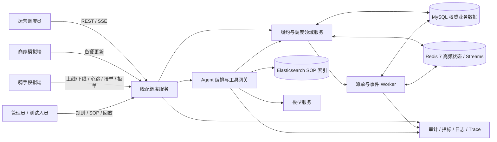
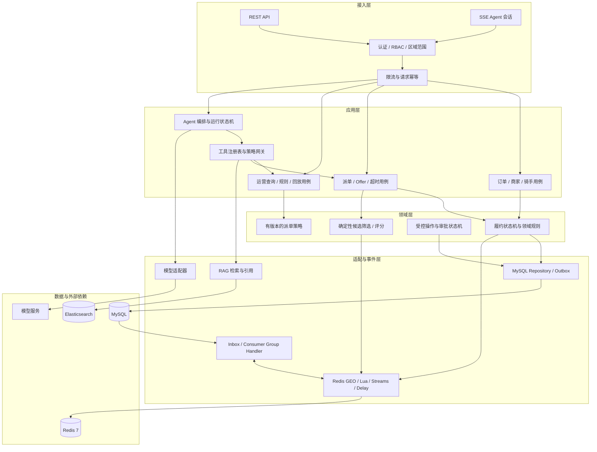
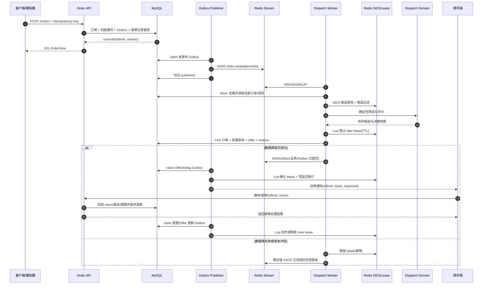
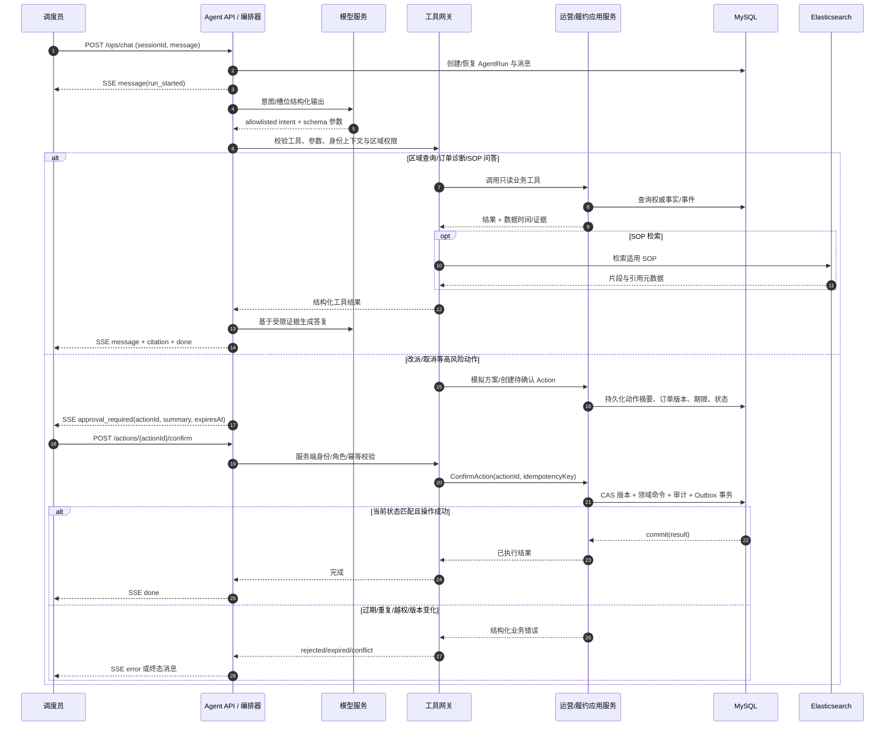
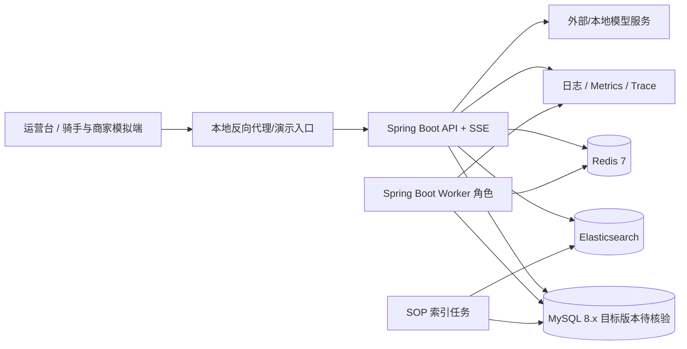
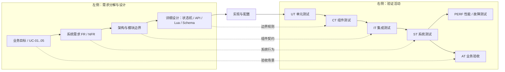

# 峰配调度 Agent（PeakDispatch）概要设计

| 项目 | 内容 |
|---|---|
| 文档类型 | 概要设计说明书 |
| 文档版本 | 0.2（演示实现基线） |
| 日期 | 2026-10-08 |
| 状态 | 演示实现基线；关联需求分析 0.2 |
| 目标读者 | 产品/运营、架构师、开发者、测试人员、评审者 |
| 需求基线 | `docs/requirements-analysis.md` 中的 30 项 FR/NFR 编号及 UC-01 至 UC-05 |

## 1. 文档目的与范围

本文将需求分析转化为可实施的系统边界、组件职责、关键数据流、接口草案、恢复策略与验证方案。它用于指导后续详细设计、工程初始化、开发和测试；性能验收当前采用 `agent-support-baseline-v1`，严格生产级目标作为后续优化项。需求编号保持原样，作为设计、接口、测试和验收材料之间的追踪主键。

设计覆盖订单与履约状态、商家备餐、骑手位置和容量、确定性派单与超时重试、多单拼单预览、运营 Agent、SOP 检索、受控改派/取消、审计、仿真回放和运行验证。支付、结算、真实平台生产接入、真实导航/交通预测不在本期范围内。

**已确定的设计**

- 逐订单实时派单完全由确定性履约/调度代码完成；LLM 不在派单热路径，不持有业务写权限。
- MySQL 是订单、派单结果、确认动作、事件和审计的权威事实源。Redis 提供可重建的高频索引、短期租约、队列与限流能力；Elasticsearch 保存可重建的 SOP 检索索引。
- 写操作均由服务端业务规则校验、版本条件更新和幂等记录保护。高影响 Agent 操作须绑定用户确认后才能调用同一业务命令服务。
- MVP 先采用单体代码库中的模块化分层，可将 API 与 Worker 以相同应用制品、不同运行角色部署和独立扩缩容。

**关键假设**

- MVP 面向单一组织和有限运营区域；认证身份、区域数据范围与角色由服务端上下文提供。跨租户隔离和复杂组织层级暂不设计为首期功能。
- 订单、骑手、商家及地图数据可由仿真器生成。位置到达商家的距离/ETA 由可替换的模拟路线适配器提供。
- 调度策略首期采用有版本的确定性筛选及评分规则；拼单只做有上限的确定性方案预览，不承诺全局最优。
- Redis 事件消费为至少一次；业务效果依靠 MySQL 唯一约束、Inbox/幂等表、状态 CAS 和可重放 Outbox 保证至多一次生效。
- 演示固定为单区域、顺序单骑手 Offer、容量上限 3、Offer TTL 30 秒和每单最多 5 轮；其余参数、性能目标和恢复边界以详细设计第 17 节为准。

演示基线默认值见第 15 节；生产身份、外部模型/地图、跨区域调度和生产高可用不在本期范围。性能与兼容性均需按指定测试执行，文档不声称已实测。

## 2. 设计原则与约束

1. **事实与索引分离**：MySQL 事实提交成功后才对外确认；Redis 丢失可从数据库重建，不能由 Redis 单独证明订单已派出或已取消。
2. **热路径确定性**：输入、规则版本和候选集固定时，调度评分可复现；模型服务中断不影响订单派单。
3. **先校验再产生副作用**：API、消息和 Agent 工具最终进入同一领域命令服务；权限、状态、容量、版本和幂等校验集中执行。
4. **至少一次传递、幂等效果**：发布/消费失败允许重试；以 `eventId`、`idempotencyKey`、offer 令牌及数据库唯一键识别重复，而非依赖“恰好一次”传输。
5. **短租约而非永久锁**：Redis 运力预占必须带到期时间，数据库提交后确认；崩溃、拒单、超时和取消均有释放路径及后台对账。
6. **可观测和可解释**：订单事件、调度轮次、规则版本、Agent run、工具调用、审批动作与 trace/run ID 关联；业务回答引用具体数据时间或 SOP 来源。
7. **最小权限和显式边界**：Agent 工具注册表为 allowlist，工具只暴露窄业务能力；禁止模型直接连数据库、发任意 HTTP、运行 Shell 或执行动态代码。

技术基线为 Java 21、Spring Boot 3.5.x、Spring AI 兼容稳定版、MySQL 8.4 LTS、Redis 7.x 和 Elasticsearch。Spring AI 与 Redis 客户端补丁版本在工程初始化时锁定；Redis 使用 Boot BOM 管理的 Lettuce。演示部署用单 Redis 主节点，Cluster-enabled 组件测试验证所有多 key Lua 同槽。

参考 [TaxiAgent 固定提交](https://github.com/ZhuofanWu/TaxiAgent/tree/61ce2bea24650d69a6d87084573f8c09c58d6eae) 中的 `OrderGrabService`，仅用于说明 Lua 预检/预占与数据库最终仲裁的组合；这不是生产正确性或 Cluster 分槽证明。路线预览后续可参考 [OR-Tools 时间窗样例](https://github.com/google/or-tools/blob/100f66e6242ab8bf8d32feb8f3bf086db66ae2b5/ortools/constraint_solver/samples/vrp_time_windows.py) 和 [取送货样例](https://github.com/google/or-tools/blob/100f66e6242ab8bf8d32feb8f3bf086db66ae2b5/ortools/constraint_solver/samples/vrp_pickup_delivery.py)；当前不引入 OR-Tools。

## 3. 系统上下文与总体架构

### 3.1 系统上下文



### 3.2 逻辑架构



### 3.3 关键组件职责与边界

| 组件 | 职责 | 不负责/边界 |
|---|---|---|
| API 层 | DTO 校验、认证上下文、响应映射、限流、幂等键接入、REST/SSE 协议 | 不放业务状态迁移和派单评分逻辑 |
| 履约领域服务 | 订单/备餐/骑手/Offer 状态迁移、业务不变量、数据库 CAS、领域事件 | 不依赖 LLM；不把缓存命中作为最终正确性判断 |
| 确定性调度服务 | 候选筛选、硬约束、评分、候选排序、策略版本和决策解释字段 | 不调用模型；不自行确认骑手、不绕过领域服务提交状态 |
| Redis 适配层 | GEO、心跳 ZSet、容量/租约 Hash、Lua、Streams、延迟 ZSet、限流 | Redis 数据可过期/重建；不持有权威订单事实 |
| 事件处理 | Outbox 发布、Consumer Group 消费、Inbox 去重、重试、Pending 恢复、DLQ | 不以 ACK 代替业务提交；不可吞掉不可恢复错误 |
| Agent 编排 | 会话/run 生命周期、意图分类、工具选择、参数结构化、SSE、恢复和有限模型重试 | 不直接持有 Repository/Redis 客户端；不决定业务事实 |
| 工具网关 | allowlist、参数 Schema、权限/范围策略、超时、审计、脱敏、错误映射 | 不接受模型构造的身份/角色，不提供任意 SQL/HTTP/Shell 工具 |
| RAG 服务 | SOP 文档版本、分块检索、引用组装和无依据降级 | ES 命中不是业务事实或授权依据；文档内容不可覆盖系统策略 |
| 审计与可观测性 | 结构化审计、指标、日志、trace 关联、敏感字段脱敏 | 不记录原始凭证或不必要的完整个人地址 |

**模块依赖方向**：API → 应用用例 → 领域规则/端口；适配器实现端口。Agent 工具网关调用应用用例，不反向依赖 Controller 或 Repository。Worker 调用与同步 API 相同的领域命令。持久化、Redis 和模型服务依赖只能从适配层进入。MVP 采用模块化单体以降低部署复杂度，API 和 Worker 可以按 profile/启动参数分角色运行；若后续拆服务，以 Outbox/事件契约作为边界，不共享数据库写表权限。

## 4. 业务模块和关键领域模型

### 4.1 模块划分

| 模块 | 核心能力 | 主要输入/输出 |
|---|---|---|
| `order` 履约订单 | 创建、查询、状态机、版本控制、事件时间线 | `CreateOrderCommand`、`OrderView`、订单领域事件 |
| `merchant` 商家备餐 | 预计出餐更新、备餐完成、重新评估触发 | `PrepUpdateCommand`、`MerchantPrepUpdated` |
| `courier` 骑手 | 上下线、心跳、位置、接单/拒单、容量视图 | `PresenceCommand`、`HeartbeatCommand`、`OfferResponseCommand` |
| `dispatch` 调度 | 候选、规则评分、运力租约、Offer 创建和轮次 | `DispatchCommand`、`DispatchDecision`、`DispatchOffer` |
| `operations` 运营 | 区域指标、诊断聚合、策略版本、仿真回放 | 指标快照、诊断证据、策略版本 |
| `agent` Agent | 意图/槽位、工具编排、会话/run、SSE、确认恢复 | `AgentRun`、工具调用和事件 |
| `knowledge` 知识库 | SOP 生命周期、ES 索引、引用元数据 | `KnowledgeDocument`、`Citation` |
| `audit` 审计 | 人工动作、权限决定、策略修改、Agent 工具轨迹 | 不可变审计事件 |
| `platform` 平台适配 | MySQL/Redis/ES/模型/路线服务接口和健康状态 | Ports/Adapters |

### 4.2 核心状态与不变量

订单状态沿用需求分析定义：`CREATED → WAITING_DISPATCH → OFFERED → ACCEPTED → PICKED_UP → DELIVERED`；拒单/Offer 超时转回 `WAITING_DISPATCH`；允许改派时 `ACCEPTED → WAITING_DISPATCH`；取消只能由领域规则允许的未完成状态转入 `CANCELLED`。每次变化必须验证 `expectedVersion`，增加版本，记录操作者、来源、时间和事件 ID。非法迁移返回业务冲突，不静默修正。

骑手容量按“已确认未完成订单 + 有效预占 Offer ≤ capacityLimit”验证，演示默认 limit=3。Redis Lua 只在单骑手 slot 预检 presence、容量投影并建立短租约；订单状态/版本、唯一活动 Offer 和容量最终由 MySQL 事务仲裁。固定锁序为 order → order slot → courier → courier_capacity → offer。Offer 记录骑手 presence generation；DB 派单和接单事务复核骑手在线状态与 generation，旧会话不能形成或接受有效 Offer。相同订单最多一个活动 Offer；活动 token、轮次和截止时间防止旧邀请迟到后被接受。拒单/超时/取消/接单竞争由 DB CAS/事务锁决定，Outbox 再更新 Redis。商家备餐 ETA 变化可触发新评估，但不得自动覆盖正在等待确认的运营动作。

### 4.3 确定性调度规则边界

调度服务先应用硬约束，再对剩余候选评分。硬约束至少包括：骑手在线且心跳在配置窗口内、取餐距离/区域范围在策略允许值内、`committed + reserved` 未达到容量上限、预测送达时间不晚于订单截止时间、候选订单/骑手状态仍有效。备餐 ETA 用于估算骑手到店等待，避免仅按当前直线距离排序。预测时间使用路线适配器返回的模拟距离/ETA；缺少 ETA 或关键数据时按策略拒绝候选或标记低置信度，不交给模型补值。

评分特征包含骑手到店 ETA、预计等餐时间、订单剩余时限/迟到风险、容量利用率和策略允许的区域因素。特征归一化与权重由带版本的 `DispatchPolicy` 配置，输出保存输入快照、特征值、权重、总分和淘汰原因。相同输入与策略版本应得相同排序；同分按稳定字段（如 courierId）排序。权重和阈值在运营规则管理中变更并审计，不由 LLM 调整。

拼单预览最多 3 单且仅同一区域；枚举取送停靠顺序，检查取餐先于送达、`committed + reserved + N ≤ capacityLimit`、备餐时间和每单 deadline，再返回总估算时间最短的可行方案并稳定处理并列。路线模拟固定为 Haversine 距离 × 1.3、20 km/h、每停靠点 2 分钟。MVP 返回候选方案与未满足约束；不创建 Offer、不改订单状态、不预占容量，也不承诺全局最优。

## 5. 关键业务流程

### 5.1 创建订单至派单及骑手响应

1. API 校验商家、取送点、预计出餐时间、截止时间和 `Idempotency-Key`；同键同请求返回原结果，同键不同请求体返回冲突。
2. 一个 MySQL 事务写入订单、初始状态事件、Outbox 记录和幂等结果。事务提交后返回订单 ID 与当前版本。
3. Outbox Publisher 扫描可发布记录，按事件 ID 将 `order.created` 放入 Redis Stream；成功后标记已发布。发布成功但标记失败时允许重复写入，由消费者去重。
4. Dispatch Worker 消费事件并创建 Inbox 去重记录；只处理当前仍为 `WAITING_DISPATCH` 的订单版本。区域 GEO 返回坐标和同槽 `versions` Hash 中的 `indexedPresenceVersion=(generation,sequence)`；评分前须核对 DB 在线状态/代次、Redis presence、区域索引版本和容量，随后确定性评分。候选代次/版本落后时 Lua 拒绝，Worker 重新查询，不能用旧坐标完成预占或有效 ETA。
5. 对候选依次请求 Redis Lua，在 rider slot 中验证在线/心跳新鲜、`(expectedPresenceGeneration,expectedSequence)` 与当前 presence 版本相等、区域匹配和容量投影可用，再创建 TTL lease。若失败尝试下一个候选；预占成功后 MySQL 事务按 order → slot → courier → capacity → offer 锁序复核 DB 在线状态/代次、订单状态/版本、活动 Offer 和容量上限，写入带 `courierPresenceGeneration` 的 Offer/事件/Outbox。数据库 `reserved` 在该 Offer 有效期间占用一个名额；事务失败时按 token 释放 Redis provisional lease，Worker 崩溃由 TTL/对账回收。
6. 只在 MySQL offer 提交成功后向骑手投递通知（仿真端可通过内部事件）；Offer 到期时间放入延迟 ZSet。骑手接受时校验 offer ID/token、未过期、订单版本/状态、骑手在线状态和当前 generation 是否等于 Offer 保存值及唯一活动分配约束，并在同一数据库事务中将该骑手容量账本从 `reserved` 转为 `committed`；订单送达或有效取消时释放 `committed`。拒绝/Offer 超时以 offer ID 幂等关闭、释放 `reserved` 并将订单重新入队。旧 token 或旧会话接受请求被拒。
7. 每步均记录 dispatch round、候选原因、规则版本、lease 状态和事件关联。Redis 故障时暂停新的预占/派单，不向调用方报告派单成功；MySQL Outbox 保留可恢复任务。



### 5.2 拒单、超时与重试

Offer 保存 `offerId`、`orderId`、`courierId`、创建时的 `courierPresenceGeneration`、`dispatchRound`、`leaseToken`、`expiresAt`、状态和订单版本。接受接口使用 CAS：仅当订单仍为 `OFFERED`、活动 Offer 相同、token 匹配、骑手仍在线且当前 generation 与 Offer 一致、数据库时间未到期时转 `ACCEPTED`。拒绝和超时操作带 `eventId`/offer 幂等键；已处理请求返回原处理结果。

延迟 Worker 用 ZSet 取到期任务后先写任务认领 lease，再回 MySQL 校验当前 Offer 仍有效。若有效，关闭 Offer、释放数据库预占、订单版本推进到 `WAITING_DISPATCH` 并产生下一轮 Outbox；若已接受/取消/改派，则标记任务完成。失败重试采用有上限的指数退避与随机抖动；耗尽后写 DLQ 并告警，不无限占用 Pending。处理顺序是先提交 MySQL 幂等状态和下一步 Outbox，再释放/更新 Redis 派生状态；Redis 操作失败可由 Outbox 重放和对账修复。

### 5.3 区域风险查询与订单诊断

区域风险工具按用户可访问区域及明确统计窗口查询领域查询服务，返回待派量、剩余时限分桶、在线骑手数、商家备餐状态、数据截止时间和指标定义。区域与时间范围缺失或歧义时先追问；响应标明来源为数据库快照/更新时间，不将模型推测当事实。单笔诊断聚合订单事件、派单轮次、候选筛选原因、商家 ETA 和失败类型，证据不足时输出“未发现记录/无法判断”，不补写原因。

### 5.4 SOP 问答

知识摄取流程校验上传者权限、文档类型和版本，解析成带文档 ID、标题、版本、章节、更新时间、适用区域、分块 ID 的索引记录。文档变更时先构建新版本索引、验证可查询，再切换活动版本并停用旧索引。Agent 检索 BM25 结果（后续可评估向量检索与 RRF），将引用片段交给模型组织语言；回答返回 citation ID/标题/章节/链接。零相关结果、索引不可用或无引用支持时明确降级为无法依据 SOP 回答。检索文本视为不可信内容。

### 5.5 人工确认后改派/取消

Agent 先调用只读模拟工具获得方案，返回目标订单、候选骑手、约束检查、预期影响、订单版本和策略版本。用户请求写操作时，服务端对范围和角色授权并建立 `AgentAction`，状态为 `PENDING_CONFIRMATION`，保存规范化动作摘要、参数 hash、目标订单版本、请求用户、确认期限和幂等键。审批卡片展示将执行的精确动作及影响；确认请求必须由同一授权用户（或经策略授权的审批角色）提交。

确认接口在事务中校验动作未过期/未拒绝、摘要未变、订单仍是预期版本/状态、权限仍有效、幂等键未执行；随后将动作标为已认领并经领域命令执行。改派仍走正常租约和派单流程，取消仍走取消规则，不直接改表。若改派仅提交了重新调度请求，结果应明确表示订单已回到 `WAITING_DISPATCH`；只有后续 Offer 创建/骑手接受事件到达时，才能报告新骑手已确认。结果、状态事件、Outbox 和审计在事务中提交。若执行后进程在响应前崩溃，重复确认按动作幂等键读取并返回原结果；若状态已变化则审批失效并要求重新模拟/确认。Agent run 从持久化状态恢复并通过 SSE 发出 `tool_start`、`message`、`done` 或 `error`。



## 6. Agent 与工具安全设计

### 6.1 执行流程与状态

意图分类输出限定枚举：`ORDER_LOOKUP`、`REGION_METRICS`、`ORDER_DIAGNOSIS`、`DISPATCH_SIMULATION`、`SOP_QA`、`RESCHEDULE`、`CANCEL_ORDER`、`UNKNOWN`。结构化参数使用工具级 Schema（必填、范围、枚举、长度、时间窗口）；低置信度或关键槽位缺失时追问，工具不因模型自由文本直接执行。

`AgentRun` 与 `AgentAction` 使用独立状态机：Run 为 `RUNNING → WAITING_CONFIRMATION → RUNNING → COMPLETED | FAILED | CANCELLED`；Action 为 `PENDING_CONFIRMATION → CLAIMED → COMPLETED | FAILED`，或 `PENDING_CONFIRMATION → REJECTED | EXPIRED | INVALIDATED`。Action 任一终态同事务写 `agent.action.resolved` Outbox，RunResumer 恢复 checkpoint 并返回对应结果，不重放写工具。数据库持久化会话摘要、消息引用、意图、模型/提示版本、工具调用、输入输出摘要、耗时/token、确认动作和最终状态。Redis 仅缓存短期 SSE 连接/节流信息，不作为 run/action 唯一记录。演示会话保留 30 天，审计 90 天，位置明细 24 小时。

### 6.2 工具目录草案

| 工具 | 权限 | 参数/返回关键字段 | 写入性质 |
|---|---|---|---|
| `get_region_metrics` | 区域查看 | `regionId, from, to, buckets` → 指标、`asOf`、指标定义 | 只读 |
| `get_order_timeline` | 订单查看且区域匹配 | `orderId` → 状态、版本、事件、Offer 轮次和原因码 | 只读 |
| `diagnose_order` | 订单查看 | `orderId` → 证据、缺失项、诊断规则版本 | 只读 |
| `simulate_dispatch` | 调度查看 | `orderIds, regionId, policyVersion?` → 候选、硬约束、ETA、影响 | 只读、确定性 |
| `search_sop` | SOP 查看 | `query, regionId?, category?` → 片段与 citation | 只读 |
| `request_reschedule` | 调度操作请求 | `orderId, expectedVersion, courierId?, reason` → action 摘要/期限 | 仅创建待确认动作 |
| `request_cancel` | 取消操作请求 | `orderId, expectedVersion, reason` → action 摘要/期限 | 仅创建待确认动作 |

模型无法调用通用数据库、Redis、HTTP、文件系统、Shell 或反射执行工具。工具网关从认证上下文传入用户和权限，不使用模型参数中的 `userId`/`role`。每次调用校验 allowlist、Schema、范围、限流、超时和审计策略。RAG 内容、用户消息和工具返回文本均按非可信输入处理。

### 6.3 确认、恢复与错误处理

确认令牌不是可单独授权的 bearer secret；服务端还要求已认证主体匹配、权限复核、动作摘要 hash、订单版本、状态和数据库有效期。重复确认返回原始执行结果；同动作不同主体拒绝；超时、拒绝或版本冲突使原 action 终结，不复用旧确认。重新连接可通过 `Last-Event-ID` 查询持久化 Agent 事件游标并补发，不依赖 SSE 连接状态推断运行结果。

工具错误分为参数错误、未授权、业务冲突/状态过期、依赖超时、限流、知识无命中、模型不可用、内部故障。可恢复的读取超时最多有限重试并带退避；写工具只按服务端幂等键重试。业务冲突以结构化错误返回 Agent 追问或要求重新模拟；模型超时结束当前 run 或降级为预设错误消息，不影响履约 Worker。SSE 断线不取消已提交业务动作。

## 7. Redis 设计

### 7.1 Key 与数据结构

统一 key 前缀为 `pd:<env>:`，`<env>` 是普通占位符，不加 hash-tag 花括号。区域、骑手、订单标识只使用规范化 ID，禁止用户文本进入 key；花括号只包围需同槽操作的实体 tag。建议 key：

| Key 模板 | 类型 | 用途 / 生命周期 |
|---|---|---|
| `pd:<env>:stream:dispatch` | Stream | 创建/重新评估/重试派单事件，持久消费流 |
| `pd:<env>:stream:events` | Stream | 需要异步处理的履约事件；按保留策略裁剪且先确认消费完成 |
| `pd:<env>:stream:dlq:<topic>` | Stream | 超过重试上限的消息及错误摘要，需运维回放 |
| `pd:<env>:geo:{<env>:<regionId>}:members` | GEO/ZSET | 在线候选粗筛；成员 ID 为 courierId，不以 key TTL 表达成员过期 |
| `pd:<env>:geo:{<env>:<regionId>}:versions` | Hash | field=riderId，value=`<generation>:<sequence>` 或 `<generation>:0` 删除 fence tombstone；按两个非负整数比较 |
| `pd:<env>:heartbeat:{<env>:<regionId>}:members` | ZSet | member=courierId，score=最后心跳 epoch ms；与区域 GEO/版本 key 同槽 |
| `pd:<env>:courier:{<env>:<courierId>}:presence` | Hash | 在线状态、presenceGeneration、sequence、位置、regionId、server time；版本为 `(generation,sequence)` |
| `pd:<env>:courier:{<env>:<courierId>}:capacity` | Hash | `limit, committed, reserved, version, ready` 派生视图 |
| `pd:<env>:courier:{<env>:<courierId>}:leases` | Hash | offer/lease token 与到期信息；短租约 |
| `pd:<env>:courier:{<env>:<courierId>}:lease-expiry` | ZSet | lease 到期索引；与同骑手 Lua 同槽 |
| `pd:<env>:offers:{<env>-offers}:due` | ZSet | member=offerId，score=expiresAt；只做触发索引，DB 再校验 |
| `pd:<env>:offers:{<env>-offers}:claims` | ZSet | 延迟任务短租约认领，到期后可接管 |
| `pd:<env>:offers:{<env>-offers}:payload` | Hash | offerId → dueAt epoch ms |
| `pd:<env>:offers:{<env>-offers}:claim-owners` | Hash | offerId → fencing token |
| `pd:<env>:stream:dlq:consumer:{<env>-consumer-dlq}` | Stream | Consumer DLQ；同槽 `:dedupe` Hash 按 sourceStream/sourceRecordId 幂等写入 |
| `pd:<env>:delay:{<env>-reconcile}:due` | ZSet | 待重建/补偿对象 ID 与计划时间 |
| `pd:<env>:idem:<scope>:<keyHash>` | String/Hash | 短期请求快速去重缓存；数据库 idempotency 表为权威 |
| `pd:<env>:limit:<dimension>:<id>` | String/Hash | Lua 固定窗口/令牌桶计数，窗口结束自动过期 |

`<env>` 是普通 key 前缀占位符，花括号只用于实际 Redis Cluster hash tag；禁止 `pd:{env}:` 这种环境 tag，否则同环境 key 会被集中到同一 slot。骑手脚本 key 共用 `{<env>:<courierId>}`，区域 GEO/版本/heartbeat key 共用 `{<env>:<regionId>}`，延迟 offers key 共用 `{<env>-offers}`。所有有 TTL 的键只用于缓存/租约/限流；订单、确认动作和未完成事件不允许只由 TTL 删除。骑手容量 Hash 不可在存在活动 Offer 时独立过期；丢失时暂停预占并从数据库重建。心跳超时由 score cutoff 查询并逐个清除成员，不能对整个 GEO key 设置 TTL。演示 freshness 为 90 秒、presence TTL 为 120 秒。

### 7.2 Lua 原子校验与 Cluster 限制

运力脚本只在单个骑手 hash slot 内原子校验 presence、区域、心跳新鲜度、capacity 投影和 lease，并建立 provisional lease。MySQL 事务再按固定顺序锁 order → order slot → courier → courier_capacity → offer，复核 DB 在线状态与会话代次、订单状态/版本、唯一活动 Offer 和 `committed+reserved < limit`，最终仲裁并写 Offer、事件及 Outbox。接单/拒绝/超时/取消/送达也由 MySQL 状态转换裁决，再经 Outbox 更新 rider-scoped Lua 投影；DB 失败按 token 补偿 provisional lease。Redis 永远不负责原子验证订单状态。

Redis Cluster 中，Lua 涉及的所有 `KEYS[]` 必须位于同一个 hash slot。骑手相关 key 示例为 `pd:demo:courier:{demo:c-17}:capacity` 和 `pd:demo:courier:{demo:c-17}:leases`；脚本不同时访问订单 key、区域索引或全局 Stream。候选携带区域索引的 `indexedPresenceVersion=(generation,sequence)`，`reserveCourierLease` 校验 generation、sequence 与当前 rider presence 相等且 region 相同；版本不匹配返回 stale 并要求重查，不得继续使用旧位置计算有效 ETA。区域 GEO、versions Hash 和 heartbeat ZSet 以 `{demo:r-1}` 同槽，区域更新 Lua 按数值先比 generation、再比 sequence，只接受更大版本。实现前用 `CLUSTER KEYSLOT` 检查 key，并运行 Cluster-enabled Lua 组件测试。

每次上线/重连/下线由 MySQL 持久化递增 `presence_generation`，会话变化与 `courier.presence_changed` Outbox 同事务提交。在线 API 写入当前 `region_id`，通过幂等 `startCourierPresence` 投影建立 `online=1,sequence=0` 的 presence 后才返回 generation 和首个序号 1；下线事件通过按代次校验的 `stopCourierPresence` 删除旧 presence，再由区域索引清理任务删除旧 GEO/ZSet 成员。重连/切区先清理旧 generation 的 presence，再初始化新 generation；旧清理未确认前不报告新会话可用。投影失败可重试且不返回可用会话。Heartbeat API 在 MySQL 事务中锁 courier 行，校验当前在线状态、generation 和区域后调用 `updateCourierPresence`，成功后提交并释放锁，再更新区域索引；上下线与心跳由同一行锁串行化。心跳 Lua 要求 key 已存在、代次匹配且 sequence 严格递增，并原子保存坐标、区域、server time。Redis key 缺失时心跳 fail closed，显式重连须取得新 generation。重复会话事件不得重置 sequence，旧 generation 事件不得覆盖新 generation。区域索引清理在版本 Hash 中保留 `(currentGeneration,0)` tombstone fence，拒绝任何迟到的旧代次索引更新，避免清理完成后旧 GEO 成员复活。

随后区域索引 Lua 在该区域 `{<env>:<regionId>}` slot 内按 generation、sequence 数值比较 rider 的已索引版本，只接受更大版本并一起更新 GEO、版本 Hash 和 heartbeat ZSet。候选带 `indexedPresenceVersion`；评分要求 DB 在线/代次、rider presence 和区域索引版本相符，rider Lua 在预占时再次校验版本和区域。MySQL 派单事务锁 courier 行复核在线状态及 generation，并把代次写入 Offer；接单再核验该代次，会话变化则失效 Offer、释放容量并重派。心跳乱序不能回写有效旧坐标；索引写失败可造成漏候选，但不能用旧位置完成有效 ETA/预占，修复任务从当前 presence 按复合版本重建。跨 slot 的区域索引与骑手 presence 不承诺原子一致。Redis 不可用或派生计数置信度不明时，停止新增预占，依靠持久事件待恢复，不能跳过容量检查。

### 7.3 Streams、Pending 与延迟任务

- 以 Consumer Group 消费 `dispatch`、`events`。消费者以 `eventId` 建立带处理租约的 Inbox claim；Inbox 最终 `PROCESSED` 与业务状态、Offer 和必要 Outbox 在同一 DB 事务提交后才 `XACK`。处理中崩溃时 claim 租约过期可重领，已处理事件重放时直接 ACK，不重复执行业务副作用。
- Worker 崩溃遗留 Pending 消息，由后台恢复器定期 `XPENDING` 检查 idle time，并以 `XAUTOCLAIM` 转交超时未处理消息；避免对仍在运行的慢任务提前抢占。claim 次数、最后错误和首次时间可落库或写入可查询字段。
- 可重试错误使用受限退避并继续 Pending 或重新入流，达到次数上限转 DLQ，附 `eventId`、payload hash、错误码和 traceId。DLQ 回放保留原 eventId 并通过新 replay metadata 记录操作者与时间，业务 Inbox 防重复。
- 延迟 ZSet 只提供到期候选；同槽 Lua 原子写入 due/payload、认领短租约和独立 claim token，释放也原子重排；Worker 再核对 MySQL Offer 状态。定时扫描数据库可补回 Redis 丢失的延迟索引。
- Streams 容量、裁剪阈值与保留时间需按积压、Pending 和恢复窗口配置；裁剪前验证消费进度和 DLQ 策略。关键事件优先以 MySQL Outbox 为可重放来源，不能只依赖 Stream 持久化。

### 7.4 Redis 与数据库一致性、补偿

一致性采用“DB 事实先行 + Redis 预占短租约 + Outbox 派生更新 + 定期对账”：

1. DB 命令事务写事实、状态版本、业务事件、Inbox（消费命令时）和 Outbox。
2. 派单前 Redis Lua 仅建立临时 rider lease。随后数据库事务使用 order version CAS、骑手容量条件更新/行锁、活动 Offer 唯一约束确认事实分配。
3. DB 成功后 Outbox 驱动 Redis lease 确认、Stream 通知和延迟索引；若对应 Redis 状态写入失败，事件不丢失，重试或重建。
4. DB 失败则立即按 token 释放 Redis lease；实例崩溃时 TTL/过期清扫释放。释放操作幂等，token 不匹配时不减少其他 lease。
5. 对账任务按区域/分片对比活动 DB Offer、骑手容量账本与 Redis Hash/lease：补建缺失派生值、删除孤儿 lease、修正计数。高偏差时暂停该骑手或区域新预占并告警，避免错误计数放大。
6. Redis 恢复流程先检查连接与版本，再从数据库重建骑手容量、在线候选（由心跳重新上报/过期判定）、活动 Offer 延迟索引；重放 Outbox/未完成事件，再逐步开放派单。重建期间不信任旧缓存。
7. Redis Stream 故障转移可能丢失已由 Publisher 标记发布的消息。数据库恢复扫描按 `(status=WAITING_DISPATCH,next_dispatch_at)` 查找超过队列宽限期且没有活动 Offer 的订单，以条件更新推进调度轮次/下次检查时间并生成新的 `order.dispatch_requested` Outbox；业务幂等键由订单 ID、版本和调度轮次组成，防止多扫描器制造重复轮次。由此即使旧消息不在 Pending/Outbox 队列中，未完成订单也能重新入队。

数据库为最终容量仲裁：新 Offer 使用 rider capacity row `version`/条件更新或悲观行锁，在同一事务核验 `committed + reserved < limit` 后增加 `reserved`；接受时 `reserved--/committed++`，拒绝、过期或取消未接受 Offer 时 `reserved--`，订单送达或已接单订单取消/改派时释放 `committed`。每次变化与订单/Offer 状态、事件和 Outbox 同事务提交。建立活动 Offer 唯一键（例如每订单只有一个活动 offer 的可实现约束/锁表）与 offer token 唯一键。履约事务锁序统一为 `order → order slot → courier → courier_capacity → offer`；会话上线/下线只锁 courier，不反向获取订单或容量锁。必要时以冲突重试处理死锁。事件消费至少一次但 Inbox 唯一约束 `(consumerName,eventId)`、状态 CAS、幂等业务键及唯一 Offer 约束共同确保业务单次效果。

## 8. 数据模型与持久化建议

### 8.1 表与索引

| 表 | 关键字段建议 | 约束/索引建议 |
|---|---|---|
| `delivery_order` | `id, merchant_id, region_id, pickup/dropoff, promised_at, prep_eta, status, version, dispatch_round, next_dispatch_at, created_at, updated_at` | `id` 主键；`(region_id,status,created_at)`、`(status,next_dispatch_at)`、`(merchant_id,status)`；坐标与地址敏感字段分权/脱敏 |
| `merchant` | `id, region_id, active, current_prep_state, version` | `(region_id,active)` |
| `courier` | `id, region_id, online_state, presence_generation, capacity_limit, version, last_position_at` | `(region_id,online_state)`；generation 是会话权威版本；实时坐标可只在 Redis |
| `courier_capacity` | `courier_id, committed_count, reserved_count, version, updated_at` | `courier_id` 唯一；条件更新/行锁用于最终容量仲裁；Offer 生命周期按状态转换两类计数 |
| `dispatch_offer` | `id, order_id, courier_id, courier_presence_generation, round_no, token_hash, status, expires_at, order_version, policy_version, score_detail` | `(order_id,round_no)` 唯一；`(courier_id,status,expires_at)`；活动 Offer 使用事务锁/活动分配表约束 |
| `dispatch_assignment` | `id, order_id, courier_id, assigned_at, released_at, status, version` | 唯一活动订单分配；查询按 courier/status 建索引 |
| `delivery_event` | `event_id, aggregate_type, aggregate_id, aggregate_version, event_type, actor, payload, occurred_at, trace_id` | `event_id` 唯一；`(aggregate_id,occurred_at)`；按保留策略归档 |
| `outbox_event` | `event_id, topic, aggregate_id, payload, created_at, published_at, attempts, next_attempt_at` | `event_id` 唯一；待发布索引 `(published_at,next_attempt_at)` |
| `inbox_message` | `consumer_name, event_id, status, attempts, processed_at, error_code` | `(consumer_name,event_id)` 唯一 |
| `api_idempotency` | `scope, key_hash, request_hash, response_status, response_body_ref, expires_at` | `(scope,key_hash)` 唯一；存储期限须覆盖客户端重试窗口 |
| `dispatch_policy` | `id, region_id, version, config_json, status, created_by, created_at` | `(region_id,version)` 唯一；变更审计、可回滚 |
| `agent_session` | `id, owner_id, region_scope, created_at, expires_at, summary_ref` | `(owner_id,updated_at)`；会话访问鉴权 |
| `agent_run` | `id, session_id, status, intent, model_id, prompt_version, started_at, ended_at, token_usage, trace_id` | `(session_id,started_at)`、`(status,updated_at)` |
| `agent_run_event` | `run_id, sequence, event_type, payload_redacted, created_at` | `(run_id,sequence)` 唯一，支持 SSE 恢复 |
| `agent_tool_call` | `id, run_id, tool_name, args_hash, result_ref, status, duration_ms, error_code` | `(run_id,created_at)`；敏感参数脱敏/摘要化 |
| `agent_action` | `id, run_id, action_type, target_id, expected_version, params_json, summary_hash, requested_by, confirmed_by, expires_at, status, idempotency_key, result_ref` | action ID 与幂等键唯一；状态/期限查询索引 |
| `audit_log` | `id, actor_id, action, target_type, target_id, decision, before_version, after_version, trace_id, created_at, details_redacted` | `(target_type,target_id,created_at)`、`(actor_id,created_at)`；限制更新删除权限 |
| `knowledge_document` | `id, title, version, status, source_hash, region_scope, effective_at, indexed_at` | `(id,version)` 唯一；保留索引切换记录 |

坐标、地址、电话及用户自由文本按数据分类限制访问和留存。MySQL DDL 细节、分区、归档与字段加密在详细设计中按演示规模和部署环境确认。ES 不保存核心订单事实。Redis Stream 是传递介质，`delivery_event`/Outbox 是可审计与重放依据。

### 8.2 并发控制和 Outbox 发布

订单更新采用 `UPDATE ... WHERE id=? AND version=? AND status IN (...)`；受影响行数为 0 即冲突，服务重新读取后返回明确业务错误或重新模拟。涉及订单和骑手容量时在一个数据库事务内按固定锁顺序验证/更新，写入 Offer、状态事件及 Outbox。规则修改产生新版本，不覆盖历史决策引用的版本。

Publisher 可通过 `SELECT ... FOR UPDATE SKIP LOCKED`（目标 MySQL 版本能力待核验）短时认领 Outbox 行；若版本/语法兼容性不同，改为带 lease 字段的条件更新。流程是 claim → XADD(eventId) → mark published。崩溃在 XADD 后会重复发布；`eventId` 去重。发布前崩溃则 claim 超时后重试。发布错误增加 attempts/nextAttemptAt；到阈值告警，Outbox 不删除，等待恢复或人工回放。另由恢复扫描覆盖 Redis 故障转移丢失的“已标记发布但未消费”派单事件，不能仅以 `published_at` 作为消费者完成证明。

## 9. API 与事件契约草案

所有 JSON 时间使用带时区 ISO-8601；内部持久化 UTC。错误响应统一包含 `code, message, traceId, retryable, details?`。成功响应包含 `data, requestId`，写命令可返回 `resourceVersion`。API 路径沿用需求分析草案，最终兼容性在详细设计确定。

### 9.1 外部接口

| 接口 | 请求关键字段 | 响应关键字段 / 失败语义 |
|---|---|---|
| `POST /api/v1/orders` | `Idempotency-Key`；商家、区域、取送点、`prepEta, deadline` | `orderId,status,version,createdAt`；校验失败 400，重复键异体 409 |
| `GET /api/v1/orders/{orderId}` | 路径 ID；认证区域范围 | 订单摘要、当前版本、履约状态；无权限返回统一 404/403 策略 |
| `PUT /api/v1/couriers/{id}/presence` | `online,regionId?,Idempotency-Key`（online=true 时 regionId 必填） | `presenceGeneration,nextSequence=1`（online 时）；投影成功后创建/返回会话 |
| `POST /api/v1/couriers/{id}/heartbeat` | `lat,lon,regionId,presenceGeneration,sequence,occurredAt` | `accepted,acceptedAt,heartbeatExpiresAt,presenceVersion=(generation,sequence)`；查 MySQL 主库校验会话，拒收过期/旧代次/乱序序号 |
| `POST /api/v1/couriers/{id}/offers/{offerId}/accept` | `offerToken,orderVersion,Idempotency-Key` | offer/订单状态和版本；过期/已失效 409 |
| `POST /api/v1/couriers/{id}/offers/{offerId}/reject` | `offerToken,reasonCode,Idempotency-Key` | 处理结果、下一轮排队状态；重复请求返回原结果 |
| `POST /api/v1/ops/chat` | `sessionId?,message,regionContext?`；身份从认证上下文读取 | `runId` 与 `text/event-stream`；不接受模型/客户端指定角色 |
| `POST /api/v1/ops/actions/{id}/confirm` | `Idempotency-Key`、确认可选备注；主体从认证上下文取 | `actionId,status,resultRef`；过期/版本变化/越权为结构化 409/403 |
| `POST /api/v1/ops/actions/{id}/reject` | 幂等键、可选原因 | `actionId,status=REJECTED`；终态重复调用返回当前结果 |
| `GET /api/v1/ops/metrics` | `regionId,from,to,granularity` | 指标值、定义、`asOf`、数据来源；窗口上限与区域范围校验 |
| `GET /api/v1/ops/runs/{runId}/events` | `Last-Event-ID` 或游标 | 通过 SSE 补发持久化事件；会话所有者/角色校验 |

演示身份采用本地种子账号，角色为 `MERCHANT`、`COURIER`、`OPS_VIEWER`、`OPS_APPROVER`。改派/取消由审批人发起或确认，确认人不能与申请人相同，种子至少提供两个审批账号；不接企业身份源。服务端对资源和区域二次授权，不能仅相信 UI 隐藏按钮。写接口必须幂等；读取按用户/角色/区域限流；Agent 与模型单独按用户、角色、区域和并发 run 限流。限流拒绝返回 `429` 和建议重试时间；依赖超时返回可重试标识但不暴露内部凭证或堆栈。

### 9.2 SSE Agent 事件

事件遵循需求定义并扩展稳定字段：

| 类型 | 关键字段 | 语义 |
|---|---|---|
| `message` | `runId,sequence,content,channel` | 面向用户的状态/答复文本 |
| `tool_start` | `runId,sequence,toolCallId,toolName,publicArgsSummary` | 开始工具调用；不泄露敏感原始参数 |
| `citation` | `runId,sequence,citationId,title,version,section,uri` | SOP 引用，可定位到来源 |
| `approval_required` | `runId,sequence,actionId,actionType,summary,expiresAt,targetVersion` | 等待人工确认，前端展示精确操作摘要 |
| `done` | `runId,sequence,status,resultRef?` | 运行到终态完成 |
| `error` | `runId,sequence,code,retryable,message` | 运行失败或安全降级 |

每事件含 `id: runId:sequence` 和事件名；重连根据 `Last-Event-ID` 重放，序号单调递增。SSE 心跳不代表业务完成，客户端断开不取消运行；订阅端校验 run 所属者和区域访问权。

### 9.3 内部事件契约

```json
{
  "eventId": "uuid",
  "eventType": "order.created",
  "schemaVersion": 1,
  "aggregateType": "DeliveryOrder",
  "aggregateId": "order-id",
  "aggregateVersion": 1,
  "occurredAt": "2026-10-08T08:00:00Z",
  "traceId": "trace-id",
  "regionId": "region-id",
  "producer": "order-service",
  "payload": {
    "merchantId": "merchant-id",
    "deadline": "2026-10-08T08:35:00Z",
    "prepEta": "2026-10-08T08:12:00Z"
  }
}
```

建议事件类型包括 `order.created`、`order.dispatch_requested`、`merchant.prep_updated`、`courier.presence_changed`、`offer.created`、`offer.accepted`、`offer.rejected`、`offer.expired`、`order.cancelled`、`policy.changed`。`courier.presence_changed` 持久化在线状态、`previousRegionId`/`regionId` 和 `presenceGeneration`；offline/切区事件触发异步补偿扫描，按 MySQL 当前 generation 在旧区域版本 Hash 建立 `(generation,0)` 删除 fence，拒绝迟到旧心跳重新写入索引，再按该代次失效旧活动 Offer、释放 reserved 并重派，使用标准订单/容量锁序和 CAS；心跳高频位置默认直写 Redis，不逐条广播到 Stream。需要审计的在线变化、关键里程碑与订单状态必须持久化。兼容字段只增不改；不兼容变化增加 `schemaVersion`，消费者对未知版本隔离并告警。

## 10. 部署视图和运行依赖



运行组件：Spring Boot API 实例承接 REST/SSE；Worker 实例消费 Streams、处理 Outbox、延迟任务和对账；MySQL 保存权威数据；Redis 7 提供 Streams/GEO/Hash/ZSet/Lua；Elasticsearch 保存 SOP 索引；模型服务经独立适配器访问；浏览器运营台与模拟端调用 API。API 与 Worker 可以独立副本、独立资源限额，但共享领域/事件契约和制品。

本地 Docker Compose 建议包含 `api`、`worker`、`mysql`、`redis`、`elasticsearch`、`frontend`，可选 `otel-collector`/指标后端和本地模型容器；开发环境以 `.env.example` 列出变量名而不提交密钥，真实凭证用本地忽略文件/环境注入。面试演示环境应提供固定种子数据、启动健康检查、区域/订单仿真器、SOP 示例、Redis 故障/Worker 重启脚本和可导出的压测报告；演示环境不得连接真实外卖账户。Compose 服务健康顺序及卷/初始化脚本需在工程阶段定义。

Elasticsearch 可本地单节点演示，生产高可用不在本概要假定。模型服务可配置为外部托管或本地兼容服务；业务 API/Worker 启动不依赖模型健康，Agent 页面需显示服务不可用状态。目标数据库和搜索引擎版本待部署环境确认。

## 11. 安全、可靠性与降级

### 11.1 安全

- 认证主体由服务端过滤器建立；工具网关和每个写命令复核角色、资源及区域范围。运营读和高影响写权限分开，取消与批量操作可要求额外审批角色。
- LLM 输出、SOP、用户文本都是不可信输入；结构化解析后仍做业务校验。提示注入不能新增工具权限或改变系统授权。
- 模型只能访问注册工具，工具返回字段最小化；无通用 SQL、任意 URL、文件和 Shell 工具。订单位置、地址、手机号不送入模型，除非确有必要且经脱敏/策略批准。
- 密钥通过环境注入/密钥管理器，不入 Git；日志和追踪对手机号、地址、令牌、token 和提示中的个人信息脱敏。仿真与生产数据分离。
- SSE、审批和历史 run 查询必须验证主体；审批操作绑定操作者、摘要、版本、期限和幂等键。审计表仅允许追加和受控归档。

### 11.2 故障降级矩阵

| 故障 | 用户/业务行为 | 自动恢复与告警 |
|---|---|---|
| 模型超时/不可用 | 派单照常；Agent run 给出可理解错误或支持受控只读降级，不执行写动作 | 有界重试、熔断、记录模型错误率/耗时/token |
| Elasticsearch 不可用 | SOP 回答标注不可用；订单查询、诊断与派单继续 | 索引任务待重试，检查版本和积压 |
| Redis 不可用 | 停止新派单预占和依赖 Redis 的高频写；保留 MySQL Outbox，不能虚报 offer 成功 | 恢复后先重建派生状态、重放事件、核对容量，再逐步恢复 |
| MySQL 不可用 | 拒绝所有会改变权威事实的业务写；不接受仅 Redis 成功的订单/Offer | 数据库恢复后重放 Outbox/待处理任务；检查未提交 lease 并释放 |
| Worker 崩溃 | API 仍可读；事件保持 Pending/Outbox，延迟处理可能变慢 | `XAUTOCLAIM`、Worker 横向恢复、积压告警 |
| SSE 断连 | 已持久化 run/action 继续；客户端可按游标恢复 | Last-Event-ID 重放；超过保留窗口提示重新读取 run 状态 |
| 消息毒性/Schema 错误 | 隔离至 DLQ，不无限重试/阻塞整组 | 记录错误、trace 与 payload hash，提供受审计回放 |

演示为单机 Compose、单 MySQL 和单 Redis 主节点，不提供高可用承诺。MySQL 每日备份并保留 7 天，演示 RPO 24 小时、RTO 4 小时；Redis 派生状态可从 MySQL/Outbox 重建，Redis 故障时暂停新预占。生产 HA、备份和恢复 SLA 不属于本基线。

## 12. 可观测性与运营管理

每个 API 请求生成 `traceId/requestId`；订单创建后将 `orderId`、`eventId`、dispatch round 传播至 Outbox/Stream/Worker；Agent 使用 `runId/sessionId/toolCallId` 并与 trace 关联。敏感字段不作为 metric label。

核心指标包括：订单创建/派单速率、派单决策耗时、候选数、无合格候选比例、offer 接受/拒绝/超时率、容量拒绝/lease 回滚数、DB CAS 冲突、Outbox 未发布数/最老年龄、Streams Pending/积压/重试/DLQ 数、Redis 延迟/错误、心跳过期数、对账偏差、Agent 工具成功率/时延、模型 token/错误/限流、审批等待/过期/冲突数、SOP 检索命中与引用率。

结构化日志保留 `traceId,orderId,offerId,eventId,runId,actionId,regionId,policyVersion,errorCode` 等可关联字段。告警优先围绕错误率、Pending/Outbox 年龄、调度 P95、DLQ、Redis/DB 健康、容量偏差和待审批积压。运营台展示指标的定义、统计窗口、`asOf` 时间和来源，避免将延迟快照展示为实时事实。

## 13. 容量与性能验证设计

性能验收采用 `agent-support-baseline-v1`：单区域稳态和规模场景订单速率达到目标的 99%，突发场景至少 140 单/秒，错误率 <1%，Worker 决策/Outbox/Stream P95 均≤30 秒，突发积压 300 秒内清空。负载仍使用 100 单/秒 10 分钟、200 单/秒 1 分钟突发、5,000 名在线骑手、20,000 个订单事件、均匀与 80% 热点分布及约 167 次/秒心跳。四类场景已完成实测；严格生产级 1 秒/2 秒/1 秒目标保留为观察项。该心跳频率仅为固定压测负载，不是业务 SLA。模型耗时不计入派单热路径。

压测设计分为三个工作负载：

1. **派单持续/突发负载**：持续 100/s 10 分钟，再以 200/s 运行 1 分钟；分别记录 Worker 决策、Outbox 提交至结果、Stream queue-wait，并验证积压清空目标。
2. **规模仿真与热点负载**：生成 ≥5,000 个骑手、≥20,000 个订单事件；单区域均匀分布和 80% 热点单元两组，固定种子与基准资源。
3. **正确性/恢复负载**：重复消息、并发 Worker、Redis 延迟/短暂不可用、Worker kill/restart、Offer 超时和接单竞争；验证有效重复分配、容量超限和非法迁移均为 0，并观察恢复时长和积压消退。

每次报告固定记录机器/容器资源、OS/JDK、API/Worker 并发、MySQL/Redis/ES 配置、数据种子、心跳/容量/出餐分布、到达速率、暖机和测量窗口。Worker 决策耗时从开始处理有效事件至 Offer 或无候选结果事务提交；`event_to_decision_latency` 从 dispatch Outbox 提交至该结果提交；`queue_wait` 从 Stream XADD 到 Worker 开始处理。另报 throughput、错误率、P50/P95/P99、Outbox 最老年龄、Stream lag/Pending、DB/Redis 延迟、连接池和 JVM 资源。结果按 `agent-support-baseline-v1` 判定，并单独记录严格生产级目标的观察差距。

正确性断言由数据库事实查询和事件核对得出，不以 Redis 计数或 API 响应数代替：同订单活动分配 ≤1、`committed+reserved ≤ capacityLimit`、状态迁移符合状态机、重复 eventId 不增加业务效果、过期 token 接受数为 0。仿真业务改善只与同种子、同输入的规则基线比较，不外推为真实线上收益。

## 14. V 模型设计追踪



右侧用例 ID 是概要设计阶段的建议命名，需在测试计划中建立实际用例。下表逐项保留需求原编号，并列出设计模块、接口/数据、验证层级和关键场景。

| 需求 ID | 设计模块 | 关键接口/数据 | 测试层级与关键场景 |
|---|---|---|---|
| FR-ORD-001 | Order API/领域 | `POST /orders`、Idempotency、`delivery_order` | IT/AT：字段校验、同键重放、同键异体冲突 |
| FR-ORD-002 | Order 状态机 | `status,version,delivery_event` | UT/ST：合法迁移、非法迁移拒绝、并发 CAS 仅一方成功 |
| FR-ORD-003 | Merchant/订单重评估 | `PrepUpdateCommand`、`merchant.prep_updated` | IT/ST：重复更新幂等、ETA 变更触发新评估 |
| FR-ORD-004 | Courier/Redis Adapter | presence API、心跳 API、GEO、心跳 ZSet、MySQL generation | CT/IT：过期/旧代次/乱序心跳拒绝；切代与 lease 竞争不产生旧会话 Offer；索引失败可重建 |
| FR-ORD-005 | Dispatch/Scheduler | dispatch Stream、Lua lease、`dispatch_offer` | IT/PERF/AT：有序候选、单活动分配、容量不超限、决策 P95 统计 |
| FR-ORD-006 | Offer/延迟 Worker | accept/reject API、delay ZSet、Inbox | CT/IT/ST：拒单/超时释放，重复超时不重复释放，旧 token 拒绝 |
| FR-ORD-007 | 拼单模拟 | `simulate_dispatch`、路径/容量/时效约束 | CT/AT：返回订单集合和限制；不满足硬约束的方案不可执行 |
| FR-ORD-008 | Approval/Dispatch | Action、订单版本、幂等键 | ST：确认前无写入，版本变化/无权限/重复确认处理正确 |
| FR-AGT-001 | Agent 编排 | 意图枚举、结构化参数 Schema | CT/AT：意图限定；低置信度追问或安全降级 |
| FR-AGT-002 | Tool Gateway | allowlist、认证主体、工具 Schema | CT/SEC：越权、伪造 userId、非法参数均拒绝；无任意工具 |
| FR-AGT-003 | Ops Query | `/ops/metrics`、窗口/区域、`asOf` | IT/AT：与 DB 基准聚合一致，区域越权拒绝，定义和更新时间存在 |
| FR-AGT-004 | Order Diagnosis | `delivery_event`、Offer 轮次/原因码 | IT/AT：结论可追溯证据，缺失记录不臆测 |
| FR-AGT-005 | RAG/Knowledge | ES 分块、citation 元数据 | CT/AT：命中引用可定位；无命中拒答；索引切换后旧版本停用 |
| FR-AGT-006 | Approval/Agent Run | `agent_action`、confirm/reject API | IT/ST：确认绑定主体/摘要/版本/期限；重复、过期、越权、状态变化验证 |
| FR-AGT-007 | SSE/Agent Run Event | `message/tool_start/citation/approval_required/done/error` | IT/ST：事件序号、顺序、断线游标补发、权限隔离 |
| FR-AGT-008 | 调度摘要/方案 | 确定性指标、模拟结果、规则版本 | AT：方案与工具输出一致，解释标注输入依据和限制 |
| FR-AGT-009 | Agent Audit | `agent_run/tool_call/audit_log` | IT/AT：运行轨迹、耗时/token/审批可检索且敏感信息脱敏 |
| FR-OPS-001 | Ops 查询台 | 订单/骑手/区域 API、事件时间线 | ST/AT：区域过滤与角色授权；时间线完整 |
| FR-OPS-002 | Policy 管理 | `dispatch_policy` 版本/审计 | IT/ST：版本新增、回滚、历史订单保留所用策略版本 |
| FR-OPS-003 | Knowledge 管理 | 导入/更新/停用、索引任务 | IT/AT：新索引验证后切换，停用文档不再检索 |
| FR-OPS-004 | Simulator/Replay | 固定随机种子、配置版本 | ST/PERF：相同种子和配置结果可复现并输出机器可读报告 |
| NFR-PERF-001 | Dispatch/性能测试 | 100 订单/s 目标、派单 P95 | PERF：按 `agent-support-baseline-v1` 测吞吐、P50/P95/P99、错误率、积压；严格生产级目标作为观察项 |
| NFR-PERF-002 | 仿真/容量测试 | ≥5,000 在线骑手（每 30 秒错峰心跳）、≥20,000 事件 | PERF：热点/均匀分布两组负载，记录机器、积压、心跳/DB 负载与瓶颈 |
| NFR-COR-001 | DB CAS/Redis Lease | order version、容量账本、活动 Offer | CT/IT/PERF：竞争/重复消费后重复分配、超限、非法迁移计数均为 0 |
| NFR-REC-001 | Outbox/Streams/补偿 | Pending、XAUTOCLAIM、重放、对账 | IT/ST：Worker 重启、Redis 故障恢复，未完成事件可重放且效果单次 |
| NFR-SEC-001 | Auth/Tool Gateway | RBAC、区域范围、工具 allowlist | CT/ST：越权工具、任意 SQL/Shell/URL 路径不可用 |
| NFR-SEC-002 | 数据保护 | 密钥配置、日志脱敏、环境隔离 | CT/IT：扫描密钥不入库；日志样本脱敏；生产/仿真数据隔离 |
| NFR-OBS-001 | Trace/Audit/Metrics | traceId/runId/orderId/eventId | IT/ST：端到端关联订单派单与 Agent run，错误和工具耗时可定位 |
| NFR-MAINT-001 | 状态机/Redis/工具契约 | 集中定义、契约文档、Schema | UT/CT：契约一致性检查，key/状态迁移/工具 Schema 有文档与测试 |
| NFR-TEST-001 | Simulator/Test Harness | 固定种子、自动化报告 | IT/PERF：自动输出机器可读结果；重复运行种子数据一致 |

## 15. 演示基线决策与风险

| 编号 | 演示基线决定/风险 | 实现约束与后续边界 |
|---|---|---|
| DQ-01 | 单区域、不跨区派单 | MySQL 以骑手全局容量账本最终仲裁；多区域是后续扩展，不改变 Redis Lua 的单骑手槽位 |
| DQ-02 | 单人顺序邀请 | 每轮只发一份活动 Offer，不做竞价/广播 |
| DQ-03 | Offer 30 秒、最多 5 轮、退避 5/15/30/60 秒 | 最后一轮后转运营队列；所有值配置化并写策略快照 |
| DQ-04 | 容量按并行订单数、上限 3；拼单最多 3 单只预览 | 硬约束检查取送顺序、备餐时间、容量和 deadline，不提交多单分配 |
| DQ-05 | 5,000 在线骑手/20,000 事件，骑手每 30 秒均匀错峰心跳，单区域均匀与 80% 热点两组 | 8 vCPU/16 GiB 单机 Compose 基准；心跳频率仅用于压测，实测报告记录实际资源与 DB/Redis 负载 |
| DQ-06 | 确定性 mock 模型 | 演示仅合成数据，Agent 模型不在调度热路径；外部模型需另行评审 |
| DQ-07 | Haversine×1.3、20 km/h、每站 2 分钟的模拟 ETA | 标记 `demo-haversine-v1`，不作为真实路况估计 |
| DQ-08 | 本地种子账号和四类角色，单级双主体审批 | `OPS_APPROVER` 不能确认自己申请的动作；种子提供至少两个审批账号 |
| DQ-09 | 合成数据；位置 24 小时、Run 30 天、审计 90 天 | 配置化清理，不保留真实运营个人数据 |
| DQ-10 | 单 MySQL/单 Redis 主节点的 Compose 演示 | MySQL 每日备份保留 7 天，演示 RPO 24 小时/RTO 4 小时；无生产 HA 承诺 |
| DQ-11 | Java 21、Boot 3.5.x、MySQL 8.4 LTS、Redis 7.x | Spring AI/Lettuce 补丁版本初始化时锁定；Cluster 同槽由组件测试验证 |
| RK-01 | Redis lease、DB 容量状态短暂分歧 | lease TTL、DB CAS、Outbox 补偿与周期对账；偏差时暂停相关骑手预占并告警。 |
| RK-02 | 高频热点区域和单骑手容量 key 成为瓶颈 | 记录热点/命令延迟，按区域和骑手分布压测；分片必须保持同骑手 Lua 同槽约束。 |
| RK-03 | Agent 错误解析区域/订单指代或受提示注入影响 | 缺槽位追问、工具权限隔离、最小化上下文、引用证据、对抗测试与人工确认。 |
| RK-04 | 拼单策略规模增长造成组合爆炸或难解释 | MVP 限制订单集大小并采用确定性硬约束；达到规模后评估 OR-Tools 等成熟求解器。 |
| RK-05 | 仿真改善被误当作真实业务收益 | 报告固定种子、基线与边界；所有结论注明为仿真，真实运营效果需另行验证。 |

## 16. 概要设计到详细设计的后续工作

1. 按详细设计基线初始化 Java 21/Spring Boot 3.5.x 工程，锁定 Spring AI、MySQL、Lettuce、Redis 和 Elasticsearch 的兼容补丁版本及容器清单。
2. 实现订单/Offer/Run/Action 状态机、MySQL 锁序和容量事务，发布对应 REST/SSE 与内部事件 Schema。
3. 实现 presence/区域索引版本协议、同槽 rider Lua、Outbox/Inbox、超时重试及容量重建；用 Cluster-enabled 测试验证 slot 和脚本。
4. 落地演示认证角色、双主体审批、合成数据留存、每日备份和 Redis 重建流程。
5. 建立详细设计中列出的心跳乱序、并发争抢、超时竞争、重复投递、行动终态恢复和性能用例；全部 30 项需求 ID 保持不变并进入追踪。
6. 在指定单机基准环境运行持续/突发压测和恢复测试，保存机器可读报告；目标按实际结果判定，不预写通过结论。

## 附录 A：需求编号覆盖核对

本设计追踪矩阵覆盖需求分析中的全部 30 个 FR/NFR：`FR-ORD-001` 至 `FR-ORD-008`、`FR-AGT-001` 至 `FR-AGT-009`、`FR-OPS-001` 至 `FR-OPS-004`、`NFR-PERF-001`、`NFR-PERF-002`、`NFR-COR-001`、`NFR-REC-001`、`NFR-SEC-001`、`NFR-SEC-002`、`NFR-OBS-001`、`NFR-MAINT-001`、`NFR-TEST-001`。UC-01 至 UC-05 分别映射至订单派单、区域风险、订单诊断、审批操作和拒单/超时流程；V 模型图及矩阵将其连接到集成、系统、性能和验收验证。目标数值均标为待测验收目标，未表述为已达成结果。
